# Learn tRPC 🚀

<div align="center">

[](https://opensource.org/licenses/MIT)
[](https://trpc.io)
[](https://github.com/TheLearningHubOrg/learn-trpc/actions/workflows/ci.yml)
[](https://github.com/TheLearningHubOrg/learn-trpc/releases)
[](https://www.typescriptlang.org/tsconfig/#strict)
[](https://zod.dev)

**A guide from zero to staff-level tRPC: end-to-end type-safe APIs in TypeScript without code generation.**  
Routers and procedures, Zod validation, context and middleware, links and batching, TanStack Query and Next.js integration, subscriptions over SSE and WebSockets, and running tRPC in production.

[Getting Started](#1-stage-1-foundations-mental-model--first-api) • [Procedures & Routers](#2-stage-2-procedures-routers-validation--errors) • [Context & Links](#3-stage-3-context-middleware-links--server-side-calls) • [Integrations](#4-stage-4-framework-integration-tanstack-query-nextjs--adapters) • [Real-time & Testing](#5-stage-5-subscriptions-streaming-uploads--testing) • [Production](#6-stage-6-performance-security-observability--deployment) • [Interview Prep](#7-stage-7-staff-trpc-api-engineer-interview-handbook--cheatsheet)

<br/>

<a href="https://www.buymeacoffee.com/manthanank">
  
</a>

</div>

---

## 🗺️ 7-Stage Pedagogical Roadmap

Every example in this guide is **TypeScript**. tRPC is a TypeScript-only library: its whole value is that the TypeScript compiler carries the server's procedure types to the client, so there is no meaningful way to use it from another language. The starter project runs on Node.js 22 or 24, validates input with Zod 4 and is tested with Vitest.


| Stage | Focus Domain | Core Concepts & Engineering Outcomes |
| :--- | :--- | :--- |
| **Stage 1** | **Foundations, Mental Model & First API** | `initTRPC.create()`, `t.router`, `t.procedure`, `typeof appRouter`, `createHTTPServer`, `createTRPCClient`, the GET/POST wire format and `?batch=1`. You can run a typed server and client and read their traffic with `curl`. |
| **Stage 2** | **Procedures, Routers, Validation & Errors** | `.query` vs `.mutation`, `.input()` / `.output()` with Zod 4 and Standard Schema, nested routers and `t.mergeRouters`, `TRPCError` codes and their HTTP statuses, `errorFormatter`, `inferRouterInputs` / `inferRouterOutputs`. You can design a validated CRUD router with predictable errors. |
| **Stage 3** | **Context, Middleware, Links & Server-Side Calls** | `createContext`, `t.middleware`, context narrowing in `next({ ctx })`, `.meta()`, `.concat()`, `createCallerFactory`, `httpBatchLink`, `httpLink`, `splitLink`, `loggerLink`, custom links with `observable`, `superjson` transformers. You can build auth layers and tune the client transport. |
| **Stage 4** | **Framework Integration: TanStack Query, Next.js & Adapters** | `@trpc/tanstack-react-query` (`useTRPC`, `queryOptions`, `mutationOptions`), the classic `@trpc/react-query` hooks, cache invalidation, Next.js App Router with the fetch adapter, React Server Components, Express, Fastify and AWS Lambda adapters. |
| **Stage 5** | **Subscriptions, Streaming, Uploads & Testing** | Async-generator subscriptions, `httpSubscriptionLink` (SSE), `wsLink`, `tracked()` and resumption, `httpBatchStreamLink`, `FormData` and binary inputs, testing with callers, HTTP integration tests and `localLink`. |
| **Stage 6** | **Performance, Security, Observability & Deployment** | Type-check cost in large routers, batching limits, caching headers via `responseMeta`, CORS and CSRF, rate limiting, OpenTelemetry tracing, error reporting, versioning a tRPC API, containers and serverless. |
| **Masterclasses** | **Inference internals, real-time, monorepos, multi-tenant auth, full-stack blueprint** | How the proxy client and inference helpers work, SSE vs WebSocket designs, Turborepo/pnpm layouts and editor performance, tenant-scoped authorization, and an end-to-end Next.js + tRPC application. |
| **Stage 7** | **Staff Interview Handbook** | 40+ interview Q&As covering internals, failure modes, trade-offs and migrations, plus a one-page cheatsheet. |

---

## 🆕 tRPC Versions, What's New & Migration

### V.1 Release Timeline

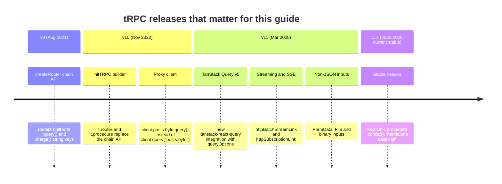

### V.2 Compatibility Matrix

| tRPC | Released | Status | TypeScript | TanStack Query | Validators | Notes |
| --- | --- | --- | --- | --- | --- | --- |
| 11.x | 2025-03-21 (11.0.0) | current stable | >= 5.7.2 (peer dependency) | v5 (`@tanstack/react-query` ^5.80.3 for the current React packages) | Zod 3.24+ and Zod 4, Valibot, ArkType, Yup, any Standard Schema validator | All `@trpc/*` packages must share the exact same version. |
| 10.x | 2022-11-21 (10.0.0) | superseded; plan a migration | >= 4.7 | v4 | Zod 3, Yup, Superstruct, custom functions | The starter in this repo was on 10.45 before this upgrade. |
| 9.x | 2021-08-25 (9.0.0) | end of life | 4.1+ | v3 | Zod, Yup | Chain API (`createRouter().query('name', {...})`). |

Runtime support for this repo: Node.js 22 and 24 (both tested in CI), strict TypeScript, ES modules.

### V.3 What's New in v11

#### `createTRPCClient` replaces `createTRPCProxyClient`

v10 had two clients, an untyped one and the proxy one. v11 keeps only the proxy client and gives it the short name. The old name still exists as an alias, so code compiles, but new code should use the new name.

```ts
// v10
import { createTRPCProxyClient, httpBatchLink } from '@trpc/client';
const client = createTRPCProxyClient<AppRouter>({ links: [httpBatchLink({ url })] });

// v11
import { createTRPCClient, httpBatchLink } from '@trpc/client';
const client = createTRPCClient<AppRouter>({ links: [httpBatchLink({ url })] });
```

#### The transformer moves from the client root to the link

In v10 the client accepted `transformer` next to `links`. In v11 every terminating link (the one that actually sends the request) takes the transformer itself. This lets different links use different serializers, for example `superjson` over HTTP and plain JSON over a WebSocket bridge.

```ts
// v10
createTRPCProxyClient<AppRouter>({ transformer: superjson, links: [httpBatchLink({ url })] });

// v11
createTRPCClient<AppRouter>({ links: [httpBatchLink({ url, transformer: superjson })] });
```

The server side is unchanged: `initTRPC.create({ transformer: superjson })`.

#### Server-side callers through `createCallerFactory`

`appRouter.createCaller(ctx)` still works, but the recommended pattern is a factory created once from the router. The factory is what React Server Components helpers and test suites build on.

```ts
// v10 style
const caller = appRouter.createCaller(ctx);

// v11 style (used in src/routers/index.ts)
export const createCaller = t.createCallerFactory(appRouter);
const caller = createCaller(ctx);
```

#### `rawInput` becomes `getRawInput()` in middleware

Inputs are no longer parsed eagerly, which is what makes streamed and `FormData` bodies possible. Middleware that inspects the unparsed input must await a function instead of reading a property.

```ts
// v10
t.middleware(({ rawInput, next }) => { audit(rawInput); return next(); });

// v11
t.middleware(async ({ getRawInput, next }) => { audit(await getRawInput()); return next(); });
```

#### Subscriptions as async generators over SSE

v10 subscriptions returned an `observable` and needed a WebSocket server. v11 subscriptions are `async function*` procedures and can run over plain HTTP with Server-Sent Events through `httpSubscriptionLink`. Observable subscriptions are deprecated. Stage 5 covers this in depth.

```ts
// v10
onTick: t.procedure.subscription(() =>
  observable<number>((emit) => {
    const id = setInterval(() => emit.next(Date.now()), 1000);
    return () => clearInterval(id);
  }),
),

// v11
onTick: t.procedure.subscription(async function* ({ signal }) {
  while (!signal?.aborted) {
    yield Date.now();
    await new Promise((r) => setTimeout(r, 1000));
  }
}),
```

#### Streaming responses with `httpBatchStreamLink`

`httpBatchLink` waits for every call in a batch before it answers. `httpBatchStreamLink` sends each result as soon as it resolves (JSON Lines over a chunked response), so one slow procedure no longer delays the fast ones in the same batch. A procedure can also return an async iterable or a promise nested in its output and the client receives the parts as they arrive.

```ts
import { httpBatchStreamLink } from '@trpc/client';

createTRPCClient<AppRouter>({ links: [httpBatchStreamLink({ url })] });
```

#### TanStack Query v5 and the new React integration

`@trpc/react-query` v11 requires TanStack Query v5, so `isLoading` on a mutation becomes `isPending` and the cache API follows v5. A second package, `@trpc/tanstack-react-query`, exposes plain `queryOptions()` / `mutationOptions()` factories that you pass to TanStack's own `useQuery`, instead of wrapping every hook. It is the recommended choice for new projects; the classic hooks remain supported.

```tsx
// classic integration (@trpc/react-query)
const items = trpc.items.list.useQuery({ status: 'todo' });

// new integration (@trpc/tanstack-react-query)
const trpc = useTRPC();
const items = useQuery(trpc.items.list.queryOptions({ status: 'todo' }));
```

#### Non-JSON inputs

Procedures can accept `FormData`, `File`, `Blob` and `Uint8Array`. The client must send those through `httpLink` (batching only carries JSON), usually routed with `splitLink` and `isNonJsonSerializable`. Stage 5 shows a working upload.

### V.4 Migration Guide (v10 → v11)

```bash
# 1. Upgrade every @trpc package to the same version, plus TanStack Query v5 if you use React.
npm install @trpc/server@^11 @trpc/client@^11
npm install @trpc/react-query@^11 @tanstack/react-query@^5   # React apps only
npm install -D typescript@^5.7                                # tRPC 11 needs TypeScript 5.7.2 or newer

# 2. Type-check and fix what the compiler reports.
npx tsc --noEmit

# 3. Optional: move React code from the classic hooks to @trpc/tanstack-react-query.
#    The official upgrade CLI rewrites trpc.x.useQuery() calls to useQuery(trpc.x.queryOptions()).
npx @trpc/upgrade
```

Then work through this list, in order:

1. Rename `createTRPCProxyClient` to `createTRPCClient`, and `inferRouterProxyClient` to `TRPCClient`.
2. Move `transformer` from the client options into each terminating link.
3. Replace `rawInput` with `await getRawInput()` in middleware.
4. Replace `isLoading` with `isPending` on mutations and on queries that have no cached data, per TanStack Query v5.
5. Convert observable subscriptions to async generators. Keep `wsLink` if you need bidirectional traffic, or move to `httpSubscriptionLink`.
6. Swap `experimental_`/`unstable_` imports for their stable names: `httpBatchStreamLink`, `httpSubscriptionLink`, `localLink`, `.concat()`.
7. Run the test suite against a real HTTP server, not only callers, because transport and serialization changes are invisible to `createCaller`.

The starter project in this repo went through exactly this path: it used `createTRPCProxyClient` and `@trpc/server@10.45`, and now runs on 11.x with `createCallerFactory`.

### V.5 Deprecations & Breaking Changes

| Version | Deprecated / removed | Replacement | What breaks and how to fix it |
| --- | --- | --- | --- |
| 11.0 | `createTRPCProxyClient` (alias kept) | `createTRPCClient` | Nothing at runtime. Rename to silence the deprecation and prepare for v12. |
| 11.0 | `transformer` option on the client | `transformer` on `httpBatchLink`, `httpLink`, `wsLink`, `httpSubscriptionLink` | Type error on the client options. Move the option into the link. |
| 11.0 | `rawInput` in middleware | `getRawInput()` (async) | Type error, or `undefined` at runtime in JS. Await the function. |
| 11.0 | Observable subscriptions | `async function*` subscriptions | Still runs, marked deprecated. Rewrite as generators; read `signal` to stop work on disconnect. |
| 11.0 | TanStack Query v4 | TanStack Query v5 | `isLoading` semantics change, `cacheTime` is `gcTime`, hooks take one options object. |
| 11.0 | TypeScript < 5.7.2 | TypeScript 5.7.2+ | Install-time peer warning and confusing inference errors. Upgrade TypeScript. |
| 11.x | `unstable_httpBatchStreamLink`, `unstable_httpSubscriptionLink`, `experimental_localLink`, `unstable_concat`, `experimental_standaloneMiddleware` | `httpBatchStreamLink`, `httpSubscriptionLink`, `localLink`, `.concat()` | Old names are deprecated aliases and are scheduled for removal in v12. |
| 11.x | `inferRouterProxyClient`, `CreateTRPCClient` types | `TRPCClient<AppRouter>` | Deprecated type aliases; rename. |

---

## 📋 Table of Contents

- [🆕 tRPC Versions, What's New & Migration](#-trpc-versions-whats-new--migration)
- [1. Stage 1: Foundations, Mental Model & First API](#1-stage-1-foundations-mental-model--first-api)
  - [1.1 What tRPC Is and the Problem It Solves](#11-what-trpc-is-and-the-problem-it-solves)
  - [1.2 How Type Safety Crosses the Wire Without Code Generation](#12-how-type-safety-crosses-the-wire-without-code-generation)
  - [1.3 Installation & First Run](#13-installation--first-run)
  - [1.4 The Smallest Complete Program](#14-the-smallest-complete-program)
  - [1.5 Starter Project Anatomy](#15-starter-project-anatomy)
  - [1.6 The Wire Protocol: What a Request Looks Like](#16-the-wire-protocol-what-a-request-looks-like)
  - [1.7 TypeScript Settings and Project Layouts](#17-typescript-settings-and-project-layouts)
  - [1.8 Pitfalls](#18-pitfalls)
  - [1.9 Best Practices](#19-best-practices)
  - [1.10 Hands-on Exercise](#110-hands-on-exercise)
- [2. Stage 2: Procedures, Routers, Validation & Errors](#2-stage-2-procedures-routers-validation--errors)
  - [2.1 Procedures: Queries, Mutations and Subscriptions](#21-procedures-queries-mutations-and-subscriptions)
  - [2.2 Input Validation with Zod and Standard Schema](#22-input-validation-with-zod-and-standard-schema)
  - [2.3 Output Validation and What the Client Really Receives](#23-output-validation-and-what-the-client-really-receives)
  - [2.4 Composing Routers](#24-composing-routers)
  - [2.5 Errors: `TRPCError`, Codes and HTTP Statuses](#25-errors-trpcerror-codes-and-http-statuses)
  - [2.6 Shaping Errors with `errorFormatter`](#26-shaping-errors-with-errorformatter)
  - [2.7 Inference Helpers and Sharing Types](#27-inference-helpers-and-sharing-types)
  - [2.8 Pitfalls](#28-pitfalls)
  - [2.9 Best Practices](#29-best-practices)
  - [2.10 Hands-on Exercise](#210-hands-on-exercise)
- [3. Stage 3: Context, Middleware, Links & Server-Side Calls](#3-stage-3-context-middleware-links--server-side-calls)
  - [3.1 Context: Per-Request Dependencies](#31-context-per-request-dependencies)
  - [3.2 Middleware: The Onion Around Every Resolver](#32-middleware-the-onion-around-every-resolver)
  - [3.3 Context Narrowing and Protected Procedures](#33-context-narrowing-and-protected-procedures)
  - [3.4 Meta, Reusable Middleware and `.concat()`](#34-meta-reusable-middleware-and-concat)
  - [3.5 Server-Side Calls with `createCallerFactory`](#35-server-side-calls-with-createcallerfactory)
  - [3.6 The Client and the Link Chain](#36-the-client-and-the-link-chain)
  - [3.7 `splitLink` and Writing a Custom Link](#37-splitlink-and-writing-a-custom-link)
  - [3.8 Data Transformers: Keeping `Date`, `Map` and `bigint` Intact](#38-data-transformers-keeping-date-map-and-bigint-intact)
  - [3.9 Pitfalls](#39-pitfalls)
  - [3.10 Best Practices](#310-best-practices)
  - [3.11 Hands-on Exercise](#311-hands-on-exercise)
- [4. Stage 4: Framework Integration: TanStack Query, Next.js & Adapters](#4-stage-4-framework-integration-tanstack-query-nextjs--adapters)
- [5. Stage 5: Subscriptions, Streaming, Uploads & Testing](#5-stage-5-subscriptions-streaming-uploads--testing)
- [6. Stage 6: Performance, Security, Observability & Deployment](#6-stage-6-performance-security-observability--deployment)
- [M1. Masterclass: Type Inference Internals](#m1-masterclass-type-inference-internals)
- [M2. Masterclass: Real-time Systems with SSE and WebSockets](#m2-masterclass-real-time-systems-with-sse-and-websockets)
- [M3. Masterclass: Monorepo and Large-Router Architecture](#m3-masterclass-monorepo-and-large-router-architecture)
- [M4. Masterclass: Authentication, Authorization and Multi-tenancy](#m4-masterclass-authentication-authorization-and-multi-tenancy)
- [M5. Masterclass: Flagship Blueprint: Full-Stack Next.js and tRPC Application](#m5-masterclass-flagship-blueprint-full-stack-nextjs-and-trpc-application)
- [7. Stage 7: Staff tRPC API Engineer Interview Handbook & Cheatsheet](#7-stage-7-staff-trpc-api-engineer-interview-handbook--cheatsheet)
  - [7.1 Core Concepts (Q1-Q4)](#71-core-concepts-q1-q4)
  - [7.5 Staff Cheatsheet](#75-staff-cheatsheet)
- [🧪 Example Projects](#-example-projects)
- [📝 Cheat Sheets](#-cheat-sheets)
- [📚 Resources](#-resources)
- [🤝 Contributing](#-contributing)
- [📄 License](#-license)
- [🙏 Acknowledgments](#-acknowledgments)
- [🌐 Connect with me](#-connect-with-me)
- [☕ Support](#-support)

---

## 1. Stage 1: Foundations, Mental Model & First API

This stage explains what tRPC is, how types travel from server to client without code generation, and what actually goes over the network. You need working TypeScript (types, generics, `async`/`await`) and Node.js 22 or newer. By the end you can run the starter server, call it from a typed client and from `curl`, and explain every file in the project.

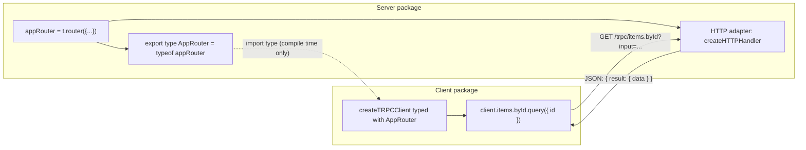

### 1.1 What tRPC Is and the Problem It Solves

tRPC is a TypeScript library for building APIs whose contract is the server code itself. You write functions on the server (called **procedures**), group them in a **router**, and export the router's *type*. The client imports that type and gets a fully typed object whose methods mirror the router. Rename a field on the server and every client call site that uses it turns red in the editor before anything runs.

Traditional API stacks keep the contract in a separate artefact: an OpenAPI document, a GraphQL schema or a `.proto` file. That artefact must be written or generated, then turned into client types by another generator, and the three copies (server code, schema, client types) drift whenever a step is skipped. tRPC removes the middle artefact. The TypeScript compiler *is* the generator, and it runs every time you save.

| Concern | REST + OpenAPI | GraphQL | gRPC | tRPC |
| --- | --- | --- | --- | --- |
| Source of truth | Handlers plus a spec that must match them | Schema (SDL or code-first) | `.proto` files | The router's TypeScript type |
| Client types | Generated from the spec | Generated from schema and operations | Generated from `.proto` | Inferred by `tsc`, nothing generated |
| Client languages | Any | Any | Any with a gRPC plugin | TypeScript only |
| Wire format | JSON over HTTP verbs and paths | JSON over one POST endpoint | Protobuf over HTTP/2 | JSON over HTTP (GET for queries, POST for mutations), optional SSE or WebSocket |
| Field selection | Fixed per endpoint | Client chooses fields | Fixed per message | Fixed per procedure |
| HTTP caching | Natural (GET + URL) | Hard (POST) without persisted queries | Not HTTP-cache friendly | Queries are GETs, so CDN caching works with `responseMeta` |
| Best fit | Public APIs, many consumers | Many clients with different data needs | Service-to-service, polyglot | A TypeScript server and TypeScript clients owned by the same team |

Use tRPC when the client and server are both TypeScript and live in one repository or one organisation: a Next.js app, a React SPA with a Node backend, a React Native app sharing a monorepo, internal tools. Do not use it as your only API when third parties, mobile apps written in Swift or Kotlin, or other-language services must call you. In that case expose REST or GraphQL for them (Stage 6 shows how to keep both), or pick a schema-first tool from the start.

### 1.2 How Type Safety Crosses the Wire Without Code Generation

The key line in every tRPC project is this one, from `src/routers/index.ts`:

```ts
export type AppRouter = typeof appRouter;
```

`typeof appRouter` asks the compiler for the full static type of the router object: every procedure, its input type (taken from the validator), its output type (taken from the resolver's return type) and its kind (query, mutation or subscription). The client then does:

```ts
import type { AppRouter } from './routers/index.js';
```

`import type` is erased by the compiler. The client bundle contains **no server code**: no database driver, no secrets, not even the router object. What it contains is a small runtime, a JavaScript `Proxy` that records the property path you walk (`client.items.byId`) and turns `.query(input)` into an HTTP request for the path `items.byId`.

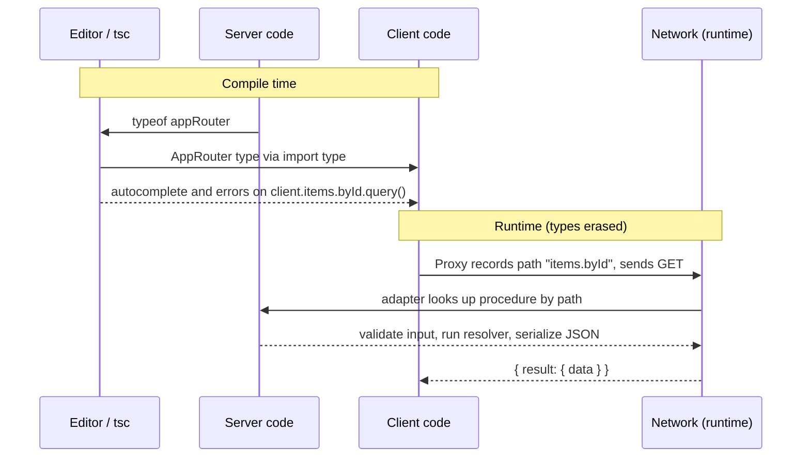

Two consequences follow, and both matter in interviews and in production:

1. **Types are a promise, validation is the enforcement.** The client's types say what the server *should* accept. Anyone can still send any bytes with `curl`, so every procedure that takes input must declare a runtime validator with `.input()`. tRPC uses that validator both to check the request and to derive the input type, so the promise and the enforcement cannot disagree.
2. **The client and server must be type-checked from the same source.** The client sees the server's types only if the compiler can read the server's source (same repo, workspace package, or published `.d.ts`). Deploying a client built against yesterday's router to talk to today's server is a version-skew problem tRPC cannot detect for you. Stage 6 covers how to deploy safely.

### 1.3 Installation & First Run

You need Node.js 22 or 24 and npm. Check with `node -v`.

```bash
# Clone and run the starter project
git clone https://github.com/TheLearningHubOrg/learn-trpc.git
cd learn-trpc
npm ci                 # installs exact versions from package-lock.json
npm test               # Vitest: router tests through callers plus real HTTP tests
npm run dev            # tsx watch src/server.ts, listening on http://localhost:8080
```

In a second terminal:

```bash
npm run client                         # typed client: batch query, mutation, refused delete
curl -s localhost:8080/health          # {"status":"ok"}
curl -s localhost:8080/trpc/system.health
```

To add tRPC to an existing project instead:

```bash
npm install @trpc/server @trpc/client zod
npm install -D typescript @types/node tsx
```

| Package | Where it runs | Purpose |
| --- | --- | --- |
| `@trpc/server` | Server | `initTRPC`, routers, procedures, errors, HTTP adapters (`/adapters/standalone`, `/adapters/fetch`, `/adapters/express`, ...) |
| `@trpc/client` | Client (browser, Node, React Native) | `createTRPCClient` and links (`httpBatchLink`, `httpLink`, `splitLink`, `wsLink`, ...) |
| `zod` | Server (and shared) | Runtime validation; any Standard Schema library works |
| `@trpc/tanstack-react-query` or `@trpc/react-query` | React client | TanStack Query integration (Stage 4) |

Keep every `@trpc/*` package on the same exact version. They share internal types, and mismatched versions produce type errors that point deep into library code.

### 1.4 The Smallest Complete Program

[`examples/01-hello.ts`](examples/01-hello.ts) contains a server and a typed client in one file. Run it with `npx tsx examples/01-hello.ts`; it prints `Hello, tRPC` and exits. CI runs every file in `examples/`, so these snippets cannot rot.

```ts
import type { AddressInfo } from 'node:net';
import { createTRPCClient, httpBatchLink } from '@trpc/client';
import { initTRPC } from '@trpc/server';
import { createHTTPServer } from '@trpc/server/adapters/standalone';
import { z } from 'zod';

const t = initTRPC.create();

const appRouter = t.router({
  greet: t.procedure
    .input(z.object({ name: z.string().min(1) }))
    .query(({ input }) => ({ message: `Hello, ${input.name}` })),
});

// Only this type crosses to the client. No code generation, no schema file.
type AppRouter = typeof appRouter;

const server = createHTTPServer({ router: appRouter });
server.listen(0, '127.0.0.1');
await new Promise((resolve) => server.once('listening', resolve));
const { port } = server.address() as AddressInfo;

const client = createTRPCClient<AppRouter>({
  links: [httpBatchLink({ url: `http://127.0.0.1:${port}` })],
});

const res = await client.greet.query({ name: 'tRPC' });
console.log(res.message); // Hello, tRPC

server.close();
```

| Line / API | Role | What happens at runtime |
| :--- | :--- | :--- |
| `initTRPC.create()` | Creates the tRPC instance `t` | Builds a root config (transformer, error formatter, `isDev`). Call it **once** per server; every router and procedure must come from the same `t`. |
| `t.router({...})` | Declares a router | Flattens nested keys into a path map (`greet`) used by the adapter to dispatch requests. |
| `t.procedure` | Base procedure builder | An immutable builder. Each `.input()`, `.use()` or `.output()` returns a new builder. |
| `.input(z.object(...))` | Runtime validator and type source | Parses the request input before the resolver. A failure becomes `BAD_REQUEST` (HTTP 400). |
| `.query(({ input }) => ...)` | The resolver | Marks the procedure as a query (served over GET). `input` is typed from the schema's output type. |
| `typeof appRouter` | The contract | Compile-time only. Erased from JavaScript output. |
| `createHTTPServer({ router })` | Standalone Node adapter | Returns a `node:http` `Server`. It maps URL paths to procedures and serializes results. |
| `server.listen(0, '127.0.0.1')` | Bind a free port | Port 0 lets the OS pick one, which is what tests want. |
| `createTRPCClient<AppRouter>` | Typed client | Returns a `Proxy`. No network activity until you call `.query()` or `.mutate()`. |
| `httpBatchLink({ url })` | Terminating link | Collects calls made in the same tick and sends them as one HTTP request. |
| `client.greet.query({ name })` | Call | Sends `GET /greet?batch=1&input={"0":{"name":"tRPC"}}` and resolves to the typed output. |

### 1.5 Starter Project Anatomy

The repository root is a small but complete tRPC API. Stages 1-3 explain every file.

```text
learn-trpc/
├── src/
│   ├── trpc.ts            initTRPC, errorFormatter, timing middleware, public/protected/admin procedures
│   ├── context.ts         createContext: reads the Bearer token, builds { user, requestId }
│   ├── store.ts           in-memory ItemStore (stands in for a database)
│   ├── routers/
│   │   ├── items.ts       list, byId, create, setStatus, delete
│   │   ├── system.ts      health, whoami
│   │   └── index.ts       appRouter, AppRouter, RouterInputs/Outputs, createCaller
│   ├── app.ts             node:http server: /health plus tRPC under /trpc
│   ├── server.ts          entrypoint: PORT, 0.0.0.0, graceful shutdown
│   └── client.ts          makeClient() and a runnable demo
├── test/
│   ├── items.test.ts      router tests through createCaller (no network)
│   └── http.test.ts       real HTTP tests: batching, status codes, zodError
├── examples/              runnable snippets used by this README (CI runs them all)
├── Dockerfile             multi-stage build, node:24-alpine, non-root, port 8080
└── .github/workflows/     ci.yml (type-check, test, examples, build, Docker smoke test)
```

The server entrypoint is deliberately tiny, so the same `createApp()` is used by `server.ts` and by the HTTP tests:

```ts
// src/server.ts
import { createApp } from './app.js';

const port = Number(process.env.PORT ?? 8080);
const host = process.env.HOST ?? '0.0.0.0';

const server = createApp();
server.listen(port, host, () => {
  console.log(`[learn-trpc] listening on http://${host}:${port} (tRPC at /trpc)`);
});

// Containers send SIGTERM; finish in-flight requests before exiting.
for (const signal of ['SIGTERM', 'SIGINT'] as const) {
  process.on(signal, () => {
    server.close(() => process.exit(0));
    setTimeout(() => process.exit(1), 10_000).unref();
  });
}
```

`app.ts` mounts tRPC under a prefix and keeps a plain `/health` route next to it. Load balancers and the Docker `HEALTHCHECK` should not depend on tRPC's envelope format.

```ts
// src/app.ts
import { createServer, type Server } from 'node:http';
import { createHTTPHandler } from '@trpc/server/adapters/standalone';
import { createContext } from './context.js';
import { appRouter } from './routers/index.js';

export const TRPC_PREFIX = '/trpc';

// One node:http server: a plain /health route for probes, tRPC under /trpc.
export function createApp(): Server {
  const trpc = createHTTPHandler({
    router: appRouter,
    createContext,
    basePath: `${TRPC_PREFIX}/`,
    onError({ path, error }) {
      if (error.code === 'INTERNAL_SERVER_ERROR') console.error(`[trpc] ${path}:`, error);
    },
  });

  return createServer((req, res) => {
    const { pathname } = new URL(req.url ?? '/', 'http://internal');
    if (pathname === '/health') {
      res.writeHead(200, { 'content-type': 'application/json' });
      res.end(JSON.stringify({ status: 'ok' }));
      return;
    }
    if (pathname.startsWith(`${TRPC_PREFIX}/`)) {
      trpc(req, res);
      return;
    }
    res.writeHead(404, { 'content-type': 'application/json' });
    res.end(JSON.stringify({ error: 'not found' }));
  });
}
```

| Line / API | Role | What happens at runtime |
| :--- | :--- | :--- |
| `createHTTPHandler({...})` | Builds a `(req, res)` listener | Same engine as `createHTTPServer`, but you own the `http.Server`, so you can add routes. |
| `basePath: '/trpc/'` | Strips the prefix | `/trpc/items.list` is dispatched as procedure path `items.list`. Without it the path would be `trpc/items.list` and return `NOT_FOUND`. |
| `onError` | Server-side error hook | Runs for every failed procedure. Log only `INTERNAL_SERVER_ERROR` (bugs); client errors such as `BAD_REQUEST` are expected traffic. |
| `host = '0.0.0.0'` | Bind all interfaces | Inside a container, `localhost` is unreachable from the host and from other containers. |
| `server.close()` on `SIGTERM` | Graceful shutdown | Stops accepting connections and lets in-flight requests finish; the timer forces exit after 10 s. |

### 1.6 The Wire Protocol: What a Request Looks Like

tRPC's HTTP format is small and readable. Knowing it lets you debug with browser dev tools and `curl`, write CDN rules, and reason about caching. Every example below is real output from the starter.

| Call | HTTP request | Notes |
| --- | --- | --- |
| Query without input | `GET /trpc/system.health` | Path is the dotted procedure path. |
| Query with input | `GET /trpc/items.byId?input=%7B%22id%22%3A%221%22%7D` | `input` is URL-encoded JSON (`{"id":"1"}`). |
| Mutation | `POST /trpc/items.create` with body `{"title":"Buy milk"}` | Requires `content-type: application/json`. |
| Batched queries | `GET /trpc/system.health,items.byId?batch=1&input={"1":{"id":"1"}}` | Paths joined by commas; inputs keyed by position. |
| Batched mutations | `POST /trpc/items.create,items.create?batch=1` with body `{"0":{...},"1":{...}}` | Same idea in the body. |

```bash
curl -s "localhost:8080/trpc/system.health,items.byId?batch=1&input=%7B%221%22%3A%7B%22id%22%3A%221%22%7D%7D"
```

```json
[
  { "result": { "data": { "status": "ok", "uptimeSeconds": 2 } } },
  { "result": { "data": { "id": "1", "title": "Read Stage 1", "status": "done", "ownerId": "u_1", "createdAt": "2026-11-03T08:24:52.617Z" } } }
]
```

Errors use a JSON-RPC 2.0 style envelope. The numeric `code` is the JSON-RPC code; `data.code` is the tRPC code you match on; `data.httpStatus` is the HTTP status that was sent:

```bash
curl -s -i localhost:8080/trpc/items.create        # GET on a mutation
```

```text
HTTP/1.1 405 Method Not Allowed
{"error":{"message":"Unsupported GET-request to mutation procedure at path \"items.create\"","code":-32005,"data":{"code":"METHOD_NOT_SUPPORTED","httpStatus":405,"path":"items.create","zodError":null}}}
```

When `NODE_ENV` is not `production`, `data.stack` also contains the server stack trace. The Docker image sets `NODE_ENV=production`, which removes it.

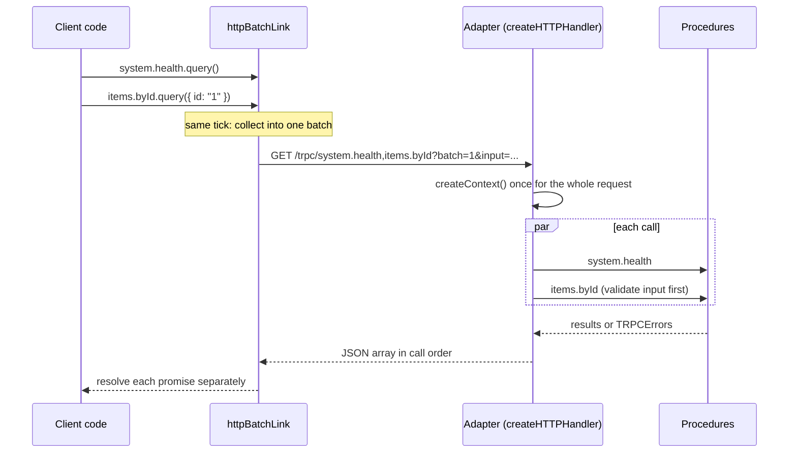

A batch fails or succeeds per call, not as a whole: one `NOT_FOUND` inside a batch rejects only that call's promise. The HTTP status of a batched response is 200 when all calls succeed, the shared error status when all fail with the same one, and 207 (Multi-Status) when results are mixed.

### 1.7 TypeScript Settings and Project Layouts

tRPC's inference depends on compiler settings. `strict: true` is required: without `strictNullChecks`, optional inputs, `null` results and context narrowing collapse into `any`-like types and the safety you came for disappears. The starter's `tsconfig.json`:

```json
{
  "compilerOptions": {
    "target": "ES2023",
    "module": "NodeNext",
    "moduleResolution": "NodeNext",
    "lib": ["ES2023"],
    "types": ["node"],
    "strict": true,
    "noUncheckedIndexedAccess": true,
    "verbatimModuleSyntax": true,
    "isolatedModules": true,
    "skipLibCheck": true,
    "forceConsistentCasingInFileNames": true,
    "noEmit": true
  },
  "include": ["src", "test", "examples", "vitest.config.ts"]
}
```

| Option | Why it matters for tRPC |
| --- | --- |
| `strict` | Required. Enables the null checks and generic inference tRPC's types rely on. |
| `module` / `moduleResolution: NodeNext` | Matches Node's ESM rules, so relative imports need `.js` extensions (`'./trpc.js'`), and `@trpc/server/adapters/...` subpath exports resolve. Bundler projects (Next.js, Vite) use `"moduleResolution": "bundler"` instead. |
| `verbatimModuleSyntax` | Forces `import type { AppRouter }`, which guarantees the server module is never pulled into a client bundle by accident. |
| `noUncheckedIndexedAccess` | Makes `record[key]` return `T \| undefined`, which catches missing-token lookups such as `DEMO_TOKENS[token]` in `context.ts`. |
| `skipLibCheck` | Speeds up type-checking; tRPC's own declarations are already checked upstream. |

The build uses a second file, `tsconfig.build.json`, that extends the first, turns emit on and compiles only `src/` into `dist/`. Tests and examples are type-checked by `npm run lint` but never shipped.

Three layouts are common:

| Layout | How the client gets `AppRouter` | Good for |
| --- | --- | --- |
| Single package (this repo) | Relative `import type` | Learning, small services, full-stack frameworks like Next.js where server and client share one project |
| Monorepo workspace (`apps/web`, `apps/api`, `packages/api`) | `import type { AppRouter } from '@acme/api'` via a workspace dependency | Several apps sharing one API; Masterclass M3 |
| Published types | The server publishes `.d.ts` files to a private registry | Separate repositories; you must version and release the types like a library |

### 1.8 Pitfalls

| Pitfall | Symptom | Fix |
| --- | --- | --- |
| Importing the router as a value on the client | Client bundle contains database drivers or fails with `Module not found: Can't resolve 'fs'` | Use `import type { AppRouter }`. Turn on `verbatimModuleSyntax` so the compiler enforces it. |
| `strict` turned off | Input and output types show as `any`, or `input` is typed `unknown` everywhere | Enable `"strict": true` in every tsconfig that compiles client or server code. |
| Mismatched `@trpc/*` versions | Type errors such as `Type 'Router<...>' is not assignable to type 'AnyRouter'` deep in `node_modules` | Pin all `@trpc/*` packages to the same version; dedupe with `npm ls @trpc/server`. |
| Binding to `localhost` in a container | `curl: (52) Empty reply from server` or connection refused from the host | Listen on `0.0.0.0`, as `src/server.ts` does. |
| Mounting under a prefix without `basePath` | Every call returns `No procedure found on path "trpc/items.list"` | Pass `basePath: '/trpc/'` to the standalone handler, or `endpoint: '/trpc'` to the fetch adapter. |
| POST without a JSON content type | `415 Unsupported content-type "application/x-www-form-urlencoded"` | Send `content-type: application/json`. The tRPC client does this automatically. |
| Calling a mutation with GET | `405 Unsupported GET-request to mutation procedure` | Use `.mutate()` / POST. Queries are GET-only by default to keep them cache-safe. |
| Missing `.js` extension in relative imports under `NodeNext` | `ERR_MODULE_NOT_FOUND` at runtime after `tsc` | Write `import { router } from '../trpc.js'` even though the file is `trpc.ts`. |
| Expecting types to protect against bad input | A `curl` with a wrong shape reaches the resolver and crashes | Every procedure that reads input declares `.input(schema)`. |

### 1.9 Best Practices

- Export only `type AppRouter` (and inference helpers) from the server for clients: it keeps server code out of client bundles.
- Create `t` once in a dedicated file (`src/trpc.ts`) and export its builders: two `initTRPC` instances produce routers that cannot be merged.
- Keep transport concerns (`app.ts`, `server.ts`) separate from routers: the same router can then be served by Express, Next.js or a test without changes.
- Keep a non-tRPC `/health` endpoint: probes stay simple and survive changes to the tRPC envelope.
- Read `PORT` from the environment and bind `0.0.0.0`: the same image then runs locally, in CI and in any orchestrator.
- Learn the wire format with `curl` early: most "tRPC is broken" reports are a wrong URL, method or content type.
- Run the client against a real server in at least one test: callers skip serialization, so only HTTP tests catch transport bugs.

### 1.10 Hands-on Exercise

Add a procedure `system.echo` that takes `{ text: string }` (1 to 200 characters) and returns `{ text, length }`.

1. Add it to `src/routers/system.ts` with a Zod input.
2. Call it from `src/client.ts` inside the existing `Promise.all`, so it travels in the same batch.
3. Call it with `curl` using a URL-encoded `input` parameter.

Expected output from `curl -s "localhost:8080/trpc/system.echo?input=%7B%22text%22%3A%22hi%22%7D"`:

```json
{"result":{"data":{"text":"hi","length":2}}}
```

And `curl -s -o /dev/null -w "%{http_code}\n" "localhost:8080/trpc/system.echo?input=%7B%22text%22%3A%22%22%7D"` prints `400`. The pattern to copy is `items.byId` in [`src/routers/items.ts`](src/routers/items.ts); the batching test in [`test/http.test.ts`](test/http.test.ts) shows how to assert it.

[Back to top ⤴️](#-table-of-contents)

---

## 2. Stage 2: Procedures, Routers, Validation & Errors

This stage covers the building blocks you write every day: procedures, input and output validation, router composition, and errors that clients can handle. It assumes Stage 1 and basic Zod. Afterwards you can design a validated CRUD router whose failure modes are explicit in its types and in its HTTP responses.

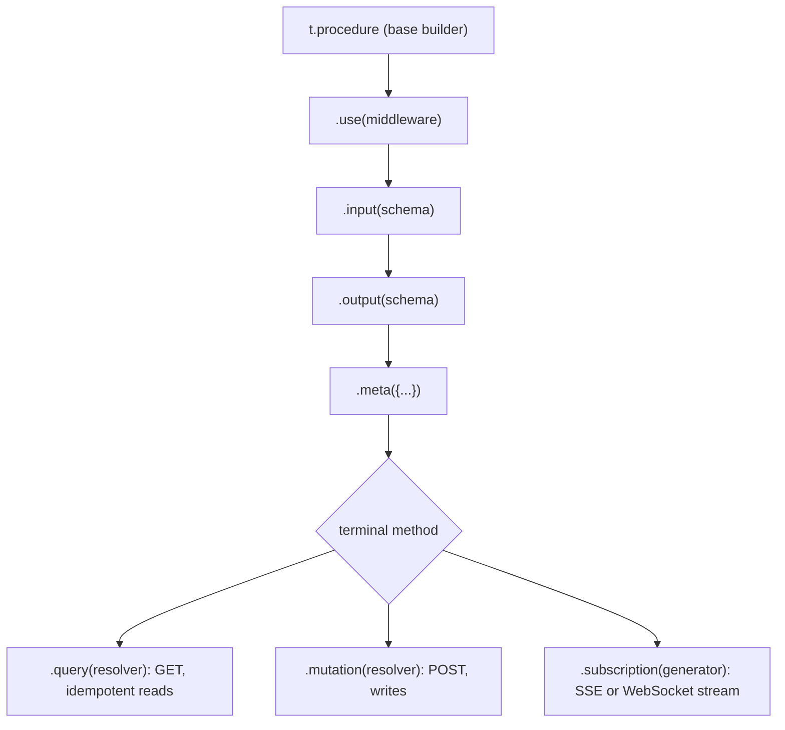

### 2.1 Procedures: Queries, Mutations and Subscriptions

A procedure is a resolver function plus the configuration built up on a **procedure builder**. Builders are immutable: every chained call returns a new builder, so a shared base such as `protectedProcedure` can be extended in many places without one use affecting another.

| Kind | HTTP | Use for | Client call |
| --- | --- | --- | --- |
| `.query()` | GET (POST only if you enable `allowMethodOverride`) | Reads with no side effects | `client.items.list.query(input)` |
| `.mutation()` | POST | Creates, updates, deletes, anything with side effects | `client.items.create.mutate(input)` |
| `.subscription()` | SSE (`httpSubscriptionLink`) or WebSocket (`wsLink`) | Streams of events | `client.x.onEvent.subscribe(input, { onData })` |

The distinction is not cosmetic. Queries are GETs, so browsers, proxies and CDNs may cache or retry them, and TanStack Query refetches them on window focus. Putting a write behind `.query()` means it can run several times without the user doing anything. The rule: if calling it twice is not the same as calling it once, it is a mutation.

The starter's items router, [`src/routers/items.ts`](src/routers/items.ts), shows all the building blocks of this stage:

```ts
import { TRPCError } from '@trpc/server';
import { z } from 'zod';
import { store } from '../store.js';
import { adminProcedure, protectedProcedure, publicProcedure, router } from '../trpc.js';

export const statusSchema = z.enum(['todo', 'doing', 'done']);

const itemOutput = z.object({
  id: z.string(),
  title: z.string(),
  status: statusSchema,
  ownerId: z.string(),
  createdAt: z.date(),
});

function getOrThrow(id: string) {
  const item = store.get(id);
  if (!item) throw new TRPCError({ code: 'NOT_FOUND', message: `Item ${id} not found` });
  return item;
}

export const itemsRouter = router({
  list: publicProcedure
    .input(z.object({ status: statusSchema.optional() }).optional())
    .query(({ input }) => store.list(input ?? {})),

  byId: publicProcedure
    .input(z.object({ id: z.string().min(1) }))
    .output(itemOutput)
    .query(({ input }) => getOrThrow(input.id)),

  create: protectedProcedure
    .input(
      z.object({
        title: z.string().trim().min(2).max(100),
        status: statusSchema.default('todo'),
      }),
    )
    .mutation(({ input, ctx }) => store.create({ ...input, ownerId: ctx.user.id })),

  setStatus: protectedProcedure
    .input(z.object({ id: z.string(), status: statusSchema }))
    .mutation(({ input, ctx }) => {
      const item = getOrThrow(input.id);
      if (item.ownerId !== ctx.user.id && ctx.user.role !== 'admin') {
        throw new TRPCError({ code: 'FORBIDDEN', message: 'Not your item' });
      }
      return store.update(input.id, { status: input.status })!;
    }),

  delete: adminProcedure
    .input(z.object({ id: z.string() }))
    .mutation(({ input }) => {
      getOrThrow(input.id);
      store.delete(input.id);
      return { id: input.id, deleted: true as const };
    }),
});
```

| Line / API | Role | What happens at runtime |
| :--- | :--- | :--- |
| `publicProcedure` / `protectedProcedure` / `adminProcedure` | Reusable bases from `src/trpc.ts` | Each already carries middleware (timing, auth, role check). Stage 3 builds them. |
| `.input(z.object({...}).optional())` | Optional input | The client may call `list.query()` with no argument; `input` is `{ status?: ... } \| undefined`. |
| `.output(itemOutput)` | Output validator | The resolver's return value is parsed before it is sent. A mismatch is a server bug and becomes `INTERNAL_SERVER_ERROR`. |
| `z.string().trim().min(2)` | Transforming validator | The resolver receives the trimmed string, so `'  Learn links  '` is stored as `'Learn links'`. |
| `statusSchema.default('todo')` | Input default | The client type marks `status` optional; the resolver type marks it required. |
| `throw new TRPCError({ code: 'NOT_FOUND' })` | Typed error | Serialized with `httpStatus: 404` and `data.code: 'NOT_FOUND'`. |
| `deleted: true as const` | Literal output type | Clients see `deleted: true`, not `boolean`. |

### 2.2 Input Validation with Zod and Standard Schema

`.input()` accepts any validator tRPC recognises: Zod (3.24+ and 4), Valibot, ArkType, Yup, Superstruct, Effect Schema, any library that implements the [Standard Schema](https://standardschema.dev) interface, or a plain function that throws. tRPC calls it with the raw input and passes the parsed result to the resolver. Because Zod distinguishes a schema's **input** type from its **output** type, tRPC exposes both: the client is typed with the input side, the resolver with the output side.

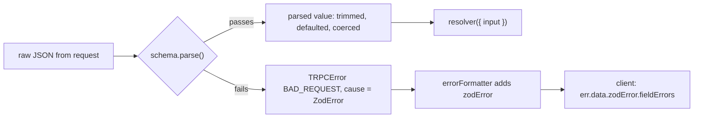

| Zod feature | Client sees (input type) | Resolver sees (output type) |
| --- | --- | --- |
| `z.string().default('x')` | `string \| undefined` | `string` |
| `z.string().trim()` | `string` | `string` (trimmed) |
| `z.coerce.number()` | `unknown` | `number` |
| `z.string().transform((s) => s.split(','))` | `string` | `string[]` |
| `z.object({...}).optional()` | object or `undefined` (argument may be omitted) | object or `undefined` |
| `z.email()` (Zod 4 top-level format) | `string` | `string` |

Chaining `.input()` more than once merges object schemas. This is how a base procedure can require an `orgId` and each procedure adds its own fields:

```ts
const orgProcedure = publicProcedure.input(z.object({ orgId: z.uuid() }));

const listProjects = orgProcedure
  .input(z.object({ limit: z.number().int().max(100).default(20) }))
  .query(({ input }) => {
    // input: { orgId: string; limit: number }
    return { orgId: input.orgId, limit: input.limit };
  });
```

Use `z.coerce` only where the raw input really is a string, such as values copied from a URL search string. Over tRPC's JSON transport, numbers already arrive as numbers, and coercion silently turns `null` into `0` and `"abc"` into `NaN` (which then fails, but with a less clear message).

### 2.3 Output Validation and What the Client Really Receives

`.output(schema)` is optional. Without it, the output type is inferred from the resolver's return type. With it, the return value is validated (and stripped of unknown keys by Zod objects) before serialization. Two reasons to use it:

1. **Data leaks.** If the resolver returns a database row, every column goes to the client, including `passwordHash`. An output schema that lists only public fields strips the rest at runtime, not just in the types.
2. **Stable contracts.** The schema documents the shape and fails loudly in tests when a refactor changes it.

The cost is a second parse per response, which matters for large lists. A common compromise is output schemas on `byId`-style procedures and on anything returning user records, and explicit `select` projections in the database layer for large lists.

There is one more transformation between resolver and client: **serialization**. With the default JSON transport, a `Date` leaves the server as an ISO string. tRPC models this in the types. In the starter, the resolver returns `createdAt: Date`, but on the client:

```ts
import type { RouterOutputs } from './routers/index.js';

type CreatedAt = RouterOutputs['items']['byId']['createdAt']; // string, not Date
```

The inferred client type is the *serialized* type, so the compiler stops you from calling `.getTime()` on what is really a string. Server-side callers skip serialization and return a real `Date`, which is why `test/items.test.ts` can assert `toBeInstanceOf(Date)`. Stage 3.8 shows how a transformer such as `superjson` keeps `Date`, `Map`, `Set` and `bigint` intact end to end.

### 2.4 Composing Routers

Routers nest. A key whose value is a router (or a plain object of procedures) becomes a namespace in the path. [`examples/02-routers.ts`](examples/02-routers.ts) shows both composition styles:

```ts
import { initTRPC, TRPCError, type inferRouterInputs } from '@trpc/server';
import { getHTTPStatusCodeFromError } from '@trpc/server/http';
import { z } from 'zod';

const t = initTRPC.create();

const usersRouter = t.router({
  get: t.procedure
    .input(z.object({ id: z.coerce.number().int().positive() }))
    .output(z.object({ id: z.number(), email: z.email() }))
    .query(({ input }) => ({ id: input.id, email: `user${input.id}@example.com` })),
});

const postsRouter = t.router({
  // Inline nesting: a plain object inside router() becomes a namespace too.
  drafts: {
    count: t.procedure.query(() => 3),
  },
});

// Two ways to compose: nest under a key, or flatten with mergeRouters.
const nested = t.router({ users: usersRouter, posts: postsRouter });
const flat = t.mergeRouters(usersRouter, postsRouter);

type Inputs = inferRouterInputs<typeof nested>;
// z.coerce accepts unknown input, so the inferred input type allows the string.
const getUserInput: Inputs['users']['get'] = { id: '42' };

const caller = t.createCallerFactory(nested)({});
console.log(await caller.users.get(getUserInput)); // { id: 42, email: ... } (coerced from "42")
console.log(await caller.posts.drafts.count()); // 3
console.log(Object.keys(flat._def.procedures)); // [ 'get', 'drafts.count' ]

for (const code of ['BAD_REQUEST', 'UNAUTHORIZED', 'NOT_FOUND', 'CONFLICT'] as const) {
  console.log(code, getHTTPStatusCodeFromError(new TRPCError({ code })));
}
```

| Approach | Resulting paths | When to use |
| --- | --- | --- |
| Nest: `t.router({ users: usersRouter })` | `users.get` | Default. One namespace per domain, mirrors folder structure. |
| Inline object: `t.router({ drafts: { count } })` | `drafts.count` | Small groups that do not deserve their own file. |
| Flatten: `t.mergeRouters(a, b)` | `get`, `drafts.count` | Migrating from v9-style flat names, or splitting one namespace across files. Duplicate keys throw at startup. |

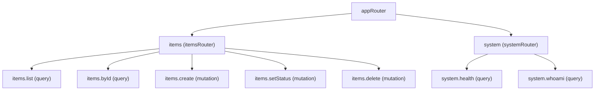

Router keys become URL segments, so treat them as public API names: camelCase, stable, and never reused for a different meaning. Some names collide with the client proxy's own properties; tRPC rejects reserved keys such as `then`, `call` and `apply` at definition time, because the client could not tell a nested router from a method call.

### 2.5 Errors: `TRPCError`, Codes and HTTP Statuses

Throw `TRPCError` for every failure the client should understand. Anything else thrown inside a resolver (a `TypeError`, a database exception) becomes `INTERNAL_SERVER_ERROR` with HTTP 500, and the original error is kept as `cause` on the server only.

| `code` | HTTP | Use when |
| --- | --- | --- |
| `PARSE_ERROR` | 400 | Body or `input` is not valid JSON (tRPC raises it) |
| `BAD_REQUEST` | 400 | Validation failed, or the request makes no sense |
| `UNAUTHORIZED` | 401 | No valid credentials |
| `PAYMENT_REQUIRED` | 402 | Plan or quota requires payment |
| `FORBIDDEN` | 403 | Authenticated, but not allowed |
| `NOT_FOUND` | 404 | Resource or procedure does not exist |
| `METHOD_NOT_SUPPORTED` | 405 | GET to a mutation, POST to a query |
| `TIMEOUT` | 408 | Server gave up waiting |
| `CONFLICT` | 409 | Unique constraint, stale version, duplicate |
| `PRECONDITION_FAILED` | 412 | Required state not met |
| `PAYLOAD_TOO_LARGE` | 413 | Body over the limit |
| `UNSUPPORTED_MEDIA_TYPE` | 415 | Wrong `content-type` |
| `UNPROCESSABLE_CONTENT` | 422 | Well-formed but semantically invalid |
| `PRECONDITION_REQUIRED` | 428 | Request must be conditional (for example, missing an expected version) |
| `TOO_MANY_REQUESTS` | 429 | Rate limited |
| `CLIENT_CLOSED_REQUEST` | 499 | Client aborted |
| `INTERNAL_SERVER_ERROR` | 500 | Bugs and unexpected failures |
| `NOT_IMPLEMENTED` | 501 | Placeholder procedures |
| `BAD_GATEWAY`, `SERVICE_UNAVAILABLE`, `GATEWAY_TIMEOUT` | 502, 503, 504 | Upstream dependency failures |

```ts
import { TRPCError } from '@trpc/server';

try {
  await db.insert(user);
} catch (err) {
  if (isUniqueViolation(err)) {
    // `cause` stays on the server for logs; the client sees code and message.
    throw new TRPCError({ code: 'CONFLICT', message: 'Email already registered', cause: err });
  }
  throw err; // unknown: becomes INTERNAL_SERVER_ERROR
}
```

On the client every failure is a `TRPCClientError`. Its `data` field is typed from the server's error shape, so you can switch on `err.data?.code` without casting:

```ts
import { TRPCClientError } from '@trpc/client';
import type { AppRouter } from './routers/index.js';

function isAppError(err: unknown): err is TRPCClientError<AppRouter> {
  return err instanceof TRPCClientError;
}

try {
  await client.items.create.mutate({ title: '' });
} catch (err) {
  if (isAppError(err) && err.data?.code === 'BAD_REQUEST') {
    console.log(err.data.zodError?.fieldErrors.title); // [ 'Too small: expected string to have >=2 characters' ]
  }
}
```

Messages of `INTERNAL_SERVER_ERROR` errors are sent to the client as-is, so never put secrets, SQL or stack fragments in them. In production (`NODE_ENV=production`) tRPC omits `data.stack`; it does not rewrite messages for you.

### 2.6 Shaping Errors with `errorFormatter`

The error formatter runs for every error before it is serialized, and its return type becomes the type of `err.data` on the client. The starter adds a flattened Zod error so forms can show messages per field:

```ts
// src/trpc.ts (excerpt)
import { initTRPC, TRPCError } from '@trpc/server';
import { z } from 'zod';
import type { Context } from './context.js';

const t = initTRPC.context<Context>().create({
  errorFormatter({ shape, error }) {
    const cause = error.cause;
    return {
      ...shape,
      data: {
        ...shape.data,
        // Typed as a string-keyed record so clients can read fieldErrors.title etc.
        zodError:
          cause instanceof z.ZodError
            ? z.flattenError(cause as z.ZodError<Record<string, unknown>>)
            : null,
      },
    };
  },
});
```

| Line / API | Role | What happens at runtime |
| :--- | :--- | :--- |
| `shape` | The default error shape | `{ message, code, data: { code, httpStatus, path, stack? } }`. Spread it to keep the defaults. |
| `error.cause` | Original error | For validation failures this is the validator's error (a `ZodError` here). |
| `z.flattenError(...)` | Zod 4 helper | Produces `{ formErrors: string[], fieldErrors: { title?: string[] } }`. In Zod 3 this was `error.flatten()`. |
| Return value | New error shape | Inferred into `TRPCClientError<AppRouter>['data']` on the client, including `zodError`. |

Keep the formatter cheap and side-effect free; it is not a logging hook. Report errors in the adapter's `onError` instead, where you also get `path`, `input`, `ctx` and `type`.

### 2.7 Inference Helpers and Sharing Types

Clients rarely need to write a type by hand. The inference helpers derive them from the router:

```ts
// src/routers/index.ts
import type { inferRouterInputs, inferRouterOutputs } from '@trpc/server';
import { createCallerFactory, router } from '../trpc.js';
import { itemsRouter } from './items.js';
import { systemRouter } from './system.js';

export const appRouter = router({
  items: itemsRouter,
  system: systemRouter,
});

// The only thing the client imports from the server, and only as a type.
export type AppRouter = typeof appRouter;
export type RouterInputs = inferRouterInputs<AppRouter>;
export type RouterOutputs = inferRouterOutputs<AppRouter>;

export const createCaller = createCallerFactory(appRouter);
```

```ts
import type { RouterInputs, RouterOutputs } from './routers/index.js';

type CreateItemInput = RouterInputs['items']['create']; // { title: string; status?: 'todo' | 'doing' | 'done' }
type Item = RouterOutputs['items']['create'];            // createdAt is string (serialized)

function ItemRow(props: { item: Item }) {
  return `${props.item.title} (${props.item.status})`;
}
```

| Helper | Package | Gives you |
| --- | --- | --- |
| `inferRouterInputs<R>` | `@trpc/server` | Input type (client side of the schema) for every procedure |
| `inferRouterOutputs<R>` | `@trpc/server` | Output type after serialization |
| `inferProcedureInput<P>` / `inferProcedureOutput<P>` | `@trpc/server` | Same for one procedure, e.g. `AppRouter['items']['create']` |
| `TRPCClient<R>` | `@trpc/client` | The client object type, for passing a client around |
| `inferRouterError<R>` | `@trpc/server` | The error shape produced by your `errorFormatter` |

Share schemas, not only types, when the client also validates (for example a form library that accepts Zod). Put `statusSchema` and friends in a module that does not import server code, and import it from both sides.

### 2.8 Pitfalls

| Pitfall | Symptom | Fix |
| --- | --- | --- |
| Writes behind `.query()` | The same row is inserted several times; TanStack Query refetches on window focus | Anything with side effects is a `.mutation()`. |
| Returning raw database rows | Client devtools show `passwordHash` or internal flags | Add `.output(publicSchema)` or select only public columns. |
| Using `Date` on the client without a transformer | `TypeError: item.createdAt.getTime is not a function` in JS, or a type error in TS | Treat it as `string`, or add `superjson` on both sides (Stage 3.8). |
| Throwing plain `Error` for expected failures | Client receives `INTERNAL_SERVER_ERROR` / 500 for a not-found case; alerts fire | Throw `TRPCError` with the right code. |
| Secrets in error messages | DB connection strings visible in API responses | Put details in `cause` (server only) and keep `message` user-safe. |
| `z.coerce` everywhere | `null` becomes `0`, empty string becomes `0`, bad data accepted | Coerce only values that start as strings. |
| Two `initTRPC` instances in one app | `TypeError` or type error when merging routers, missing context fields | Export one `t` from `src/trpc.ts`. |
| Reserved router key | Startup error about a reserved word for `then` or `call` | Rename the key. |
| Zod 3 API with Zod 4 | `error.flatten is not a function` or `z.string().email()` deprecation warnings | Use `z.flattenError(err)` and `z.email()` in Zod 4. |

### 2.9 Best Practices

- One router file per domain (`items.ts`, `users.ts`), merged in `routers/index.ts`: paths, files and ownership stay aligned.
- Validate every input, even an `id`: types are not enforced at runtime and a single unvalidated procedure is an injection point.
- Prefer `.input(z.object({...}))` over bare primitives: an object can gain optional fields later without breaking clients.
- Put `.output()` on procedures that return user or account data: it is the runtime guard against leaking columns.
- Map domain errors to `TRPCError` codes in one place (a helper like `getOrThrow`): status codes stay consistent across procedures.
- Expose field-level validation errors through `errorFormatter`: clients can show them next to the right form field without parsing messages.
- Use `RouterOutputs[...]` in client code instead of hand-written interfaces: the compiler then tracks every server change.
- Name procedures as verbs or nouns consistently (`items.create`, `items.byId`): router keys are public API.

### 2.10 Hands-on Exercise

Add `items.rename`, a mutation that takes `{ id: string, title: string }`, reuses the title rules from `create`, and returns the updated item.

1. Extract the title schema from `create` into a shared `titleSchema` constant and use it in both procedures.
2. Only the owner or an admin may rename; reuse the check from `setStatus`.
3. Throw `CONFLICT` when another item already has the same title (case-insensitive).
4. Add tests to [`test/items.test.ts`](test/items.test.ts) for success, `FORBIDDEN`, `CONFLICT` and `BAD_REQUEST`.

Expected test output after `npm test`:

```text
 ✓ test/items.test.ts (11 tests)
 ✓ test/http.test.ts (6 tests)
 Test Files  2 passed (2)
```

The `setStatus` procedure in [`src/routers/items.ts`](src/routers/items.ts) and its test ("only lets the owner or an admin change status") are the patterns to follow.

[Back to top ⤴️](#-table-of-contents)

---

## 3. Stage 3: Context, Middleware, Links & Server-Side Calls

This stage covers the two pipelines around every procedure: on the server, context creation and the middleware chain; on the client, the link chain that turns calls into network traffic. It builds on Stages 1 and 2. Afterwards you can add authentication and authorization layers, call procedures without HTTP, and control batching, logging and serialization on the client.

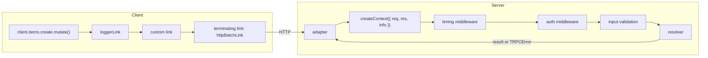

### 3.1 Context: Per-Request Dependencies

The context is the object every middleware and resolver receives as `ctx`. It is where request-scoped things live: the authenticated user, a request id, a database transaction or connection, a logger with request fields, a tenant id. It is tRPC's dependency-injection mechanism: resolvers do not import the current user from a global, they read it from `ctx`.

You declare its type once with `initTRPC.context<Context>()` and build it in `createContext`, which the adapter calls **once per HTTP request**. A batch of five calls shares one context, which is why expensive work there (a session lookup, a JWT verification) is paid once per batch, not once per call.

```ts
// src/context.ts
import type { IncomingHttpHeaders } from 'node:http';

export type Role = 'member' | 'admin';

export interface User {
  id: string;
  name: string;
  role: Role;
}

export interface Context {
  user: User | null;
  requestId: string;
}

// Demo-only token table. A real app verifies a JWT or looks up a session here.
const DEMO_TOKENS: Record<string, User> = {
  'demo-member-token': { id: 'u_1', name: 'Asha', role: 'member' },
  'demo-admin-token': { id: 'u_2', name: 'Ravi', role: 'admin' },
};

export function userFromHeaders(headers: IncomingHttpHeaders): User | null {
  const header = headers.authorization;
  if (!header?.startsWith('Bearer ')) return null;
  return DEMO_TOKENS[header.slice('Bearer '.length)] ?? null;
}

let counter = 0;

// Called once per HTTP request (once per batch, not once per procedure).
export function createContext({ req }: { req: { headers: IncomingHttpHeaders } }): Context {
  counter += 1;
  return { user: userFromHeaders(req.headers), requestId: `req_${counter}` };
}
```

| Line / API | Role | What happens at runtime |
| :--- | :--- | :--- |
| `interface Context` | Context type | Declared once and passed to `initTRPC.context<Context>()`. Every `ctx` in the app has this type. |
| `user: User \| null` | Optional authentication | `createContext` never throws for a missing token. Rejection belongs in middleware, so public procedures in the same batch still work. |
| `createContext({ req })` | Factory | The standalone adapter passes `{ req, res, info }`. `info` describes the request: `info.calls` (procedures in this batch), `info.isBatchCall`, `info.signal`. |
| `{ req: { headers } }` parameter type | Narrow dependency | The function accepts anything with headers, so the fetch adapter, tests and Express can reuse it. |
| `DEMO_TOKENS[...] ?? null` | Lookup | With `noUncheckedIndexedAccess` the compiler forces the `?? null` for unknown tokens. |

A common production refinement is the **inner/outer split**. `createContextInner({ user })` builds everything that does not depend on the HTTP request (database handle, services). `createContext({ req })` parses the request, then calls the inner one. Tests and server-side callers call the inner function directly, so they never fake a request object.

```ts
import type { CreateHTTPContextOptions } from '@trpc/server/adapters/standalone';
import { userFromHeaders, type User } from './context.js';
import { store } from './store.js';

export function createContextInner(opts: { user: User | null }) {
  return { user: opts.user, store, requestId: crypto.randomUUID() };
}

export function createContext({ req }: CreateHTTPContextOptions) {
  return createContextInner({ user: userFromHeaders(req.headers) });
}

export type Context = ReturnType<typeof createContextInner>;
```

### 3.2 Middleware: The Onion Around Every Resolver

Middleware is a function that runs before (and, if it awaits `next()`, after) the rest of the chain. It receives `ctx`, `path`, `type`, `meta`, `getRawInput`, `input` (after `.input()` validation when placed after it) and `next`. It must return the result of `next()` or throw.

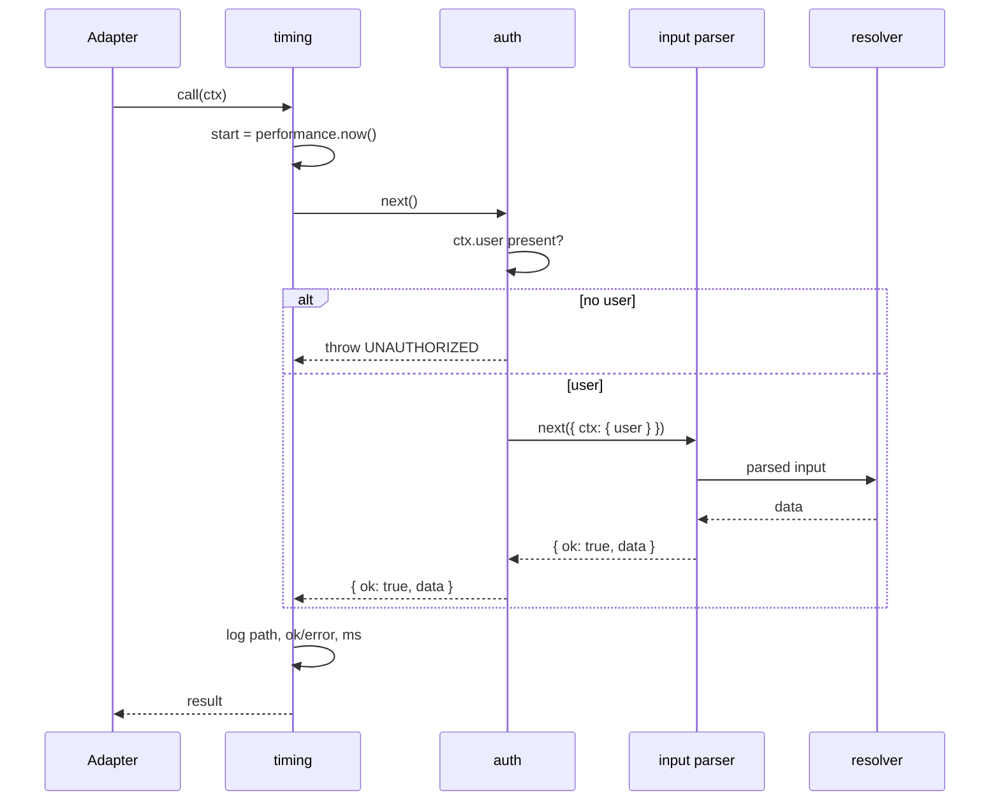

The starter's timing middleware wraps everything after it:

```ts
// src/trpc.ts (excerpt)
const timing = t.middleware(async ({ path, type, next }) => {
  const start = performance.now();
  const result = await next();
  const ms = (performance.now() - start).toFixed(1);
  if (process.env.NODE_ENV !== 'test') {
    console.log(`[trpc] ${type} ${path} ${result.ok ? 'ok' : 'error'} ${ms}ms`);
  }
  return result;
});

export const publicProcedure = t.procedure.use(timing);
```

| Line / API | Role | What happens at runtime |
| :--- | :--- | :--- |
| `t.middleware(fn)` | Defines reusable middleware | Returns a middleware builder typed against the root context. |
| `await next()` | Runs the rest of the chain | Never throws for procedure errors: failures come back as `{ ok: false, error }`. |
| `result.ok` | Outcome | `true` with `result.data`, or `false` with `result.error` (a `TRPCError`). |
| `return result` | Pass through | Returning something else would replace the response. Always return what `next()` gave you unless you mean to change it. |
| `t.procedure.use(timing)` | Attach | Middleware runs in the order of `.use()` calls. Put timing and tracing first so they measure everything. |

Order matters. Middleware placed before `.input()` cannot see `input` (use `await getRawInput()` there); middleware placed after it gets the parsed, typed value. Authentication usually goes before input parsing, so anonymous callers cannot probe validation messages.

### 3.3 Context Narrowing and Protected Procedures

`next({ ctx: {...} })` overrides context fields for the rest of the chain, and tRPC updates the *type* too. That is how `protectedProcedure` turns `user: User | null` into `user: User`, so resolvers never need a null check:

```ts
// src/trpc.ts (excerpt)
export const protectedProcedure = publicProcedure.use(({ ctx, next }) => {
  if (!ctx.user) {
    throw new TRPCError({ code: 'UNAUTHORIZED', message: 'Send a Bearer token' });
  }
  return next({ ctx: { user: ctx.user } });
});

export const adminProcedure = protectedProcedure.use(({ ctx, next }) => {
  if (ctx.user.role !== 'admin') {
    throw new TRPCError({ code: 'FORBIDDEN', message: 'Admins only' });
  }
  return next();
});
```

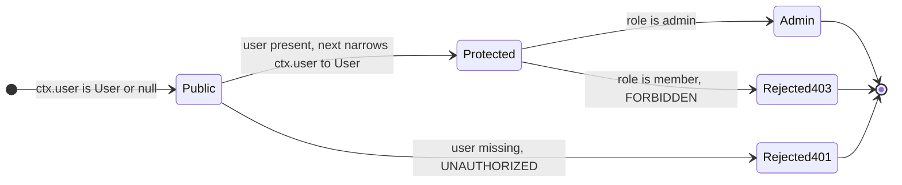

Inside `adminProcedure`, `ctx.user.role` compiles without `?.` because the previous middleware already narrowed the type. Note what the narrowing does **not** do: it does not check ownership. `setStatus` still compares `item.ownerId` with `ctx.user.id`, because resource-level authorization depends on data that middleware has not loaded. A reasonable split is: middleware for "who are you and what role do you have", resolver (or a domain service) for "may you touch this record".

| Approach | Where the check lives | Good for | Weakness |
| --- | --- | --- | --- |
| Procedure base (`protectedProcedure`) | Middleware | Authentication, roles, feature flags | Cannot see the target record |
| Input-aware middleware (after `.input()`) | Middleware reading `input.id` | Loading and checking a record once for many procedures | Couples middleware to input shapes |
| Resolver or service check | Business code | Ownership, state-dependent rules | Easy to forget in a new procedure; test it |

### 3.4 Meta, Reusable Middleware and `.concat()`

Procedures can carry static **meta** data that middleware reads. Declare its type with `.meta<Meta>()`, set it per procedure with `.meta({...})`. Use it for flags like "audit this", "required permission", or "cache for 60 s", so the policy sits next to the procedure but is enforced in one place.

`.concat()` combines two procedure builders, including builders created from a *different* `initTRPC` instance. That is how a library can ship middleware without knowing your full context: it declares only the context keys it needs, and the compiler checks that your context has them. [`examples/03-middleware.ts`](examples/03-middleware.ts):

```ts
import { initTRPC, TRPCError } from '@trpc/server';

// A "plugin" ships its own tRPC instance. It only knows the context keys it needs.
function createRateLimitPlugin(limit: number) {
  const p = initTRPC.context<{ ip: string }>().create();
  const hits = new Map<string, number>();
  return {
    procedure: p.procedure.use(({ ctx, next }) => {
      const n = (hits.get(ctx.ip) ?? 0) + 1;
      hits.set(ctx.ip, n);
      if (n > limit) throw new TRPCError({ code: 'TOO_MANY_REQUESTS' });
      return next();
    }),
  };
}

interface Ctx {
  ip: string;
  userId: string | null;
}
interface Meta {
  audit?: boolean;
}

const t = initTRPC.context<Ctx>().meta<Meta>().create({ defaultMeta: { audit: false } });

const auditLog: string[] = [];
const audited = t.procedure.use(async ({ meta, path, ctx, next }) => {
  const result = await next();
  if (meta?.audit) auditLog.push(`${ctx.userId ?? 'anon'} ${path} ${result.ok ? 'ok' : 'fail'}`);
  return result;
});

const limited = audited.concat(createRateLimitPlugin(2).procedure);

const appRouter = t.router({
  transfer: limited.meta({ audit: true }).mutation(() => 'moved'),
  ping: limited.query(() => 'pong'),
});

const caller = t.createCallerFactory(appRouter)({ ip: '10.0.0.1', userId: 'u_1' });
console.log(await caller.transfer()); // moved
console.log(await caller.ping()); // pong
const third = await caller.ping().catch((e: TRPCError) => e.code);
console.log(third); // TOO_MANY_REQUESTS
console.log(auditLog); // [ 'u_1 transfer ok' ]
```

| Line / API | Role | What happens at runtime |
| :--- | :--- | :--- |
| `initTRPC.context<{ ip: string }>()` in the plugin | Minimal context contract | The plugin compiles against `{ ip }` only. |
| `.meta<Meta>()` | Declares meta type | `.meta({ audit: true })` is type-checked against it. |
| `defaultMeta` | Fallback | Procedures without `.meta()` get `{ audit: false }`. |
| `audited.concat(plugin.procedure)` | Combine builders | Appends the plugin's middleware. If `Ctx` lacked `ip`, this line would be a type error ("Context mismatch"). |
| In-memory `Map` counter | Demo limiter | Per process only. Real rate limits need a shared store (Redis) and a key per user or IP. |

`.concat()` replaced `unstable_concat` and `experimental_standaloneMiddleware`; both old names are deprecated.

### 3.5 Server-Side Calls with `createCallerFactory`

A caller invokes procedures directly, in the same process, with a context you supply. No HTTP, no serialization, but **the full middleware chain and validation still run**. Uses: tests, React Server Components, cron jobs and queue workers that reuse business logic, and calling one procedure from a script.

```ts
// test/items.test.ts (excerpt)
import { describe, expect, it } from 'vitest';
import type { Context, User } from '../src/context.js';
import { createCaller } from '../src/routers/index.js';

const member: User = { id: 'u_1', name: 'Asha', role: 'member' };
const ctx = (user: User | null): Context => ({ user, requestId: 'test' });

describe('items router (server-side caller, no HTTP)', () => {
  it('creates an item owned by the caller with the default status', async () => {
    const caller = createCaller(ctx(member));
    const item = await caller.items.create({ title: '  Learn links  ' });
    expect(item).toMatchObject({ title: 'Learn links', status: 'todo', ownerId: 'u_1' });
    expect(item.createdAt).toBeInstanceOf(Date);
  });

  it('requires a user for mutations', async () => {
    const caller = createCaller(ctx(null));
    await expect(caller.items.create({ title: 'Anonymous' })).rejects.toMatchObject({
      code: 'UNAUTHORIZED',
    });
  });
});
```

| | Caller (`createCaller(ctx)`) | HTTP client (`createTRPCClient`) |
| --- | --- | --- |
| Runs middleware and validation | Yes | Yes |
| Runs `createContext` | No, you pass `ctx` | Yes, once per request |
| Serialization | None: `Date` stays `Date` | JSON (or transformer) |
| Errors | `TRPCError` thrown directly | `TRPCClientError` with serialized `data` |
| Batching, links, headers | Not applicable | Yes |
| Where | Same process as the router | Anywhere with network access |

Do not call procedures through a caller from *inside another procedure* to share logic. It re-runs middleware, re-validates and hides the dependency. Extract a plain function (`store.create`, a domain service) and call it from both resolvers.

### 3.6 The Client and the Link Chain

`createTRPCClient` takes an array of **links**. Each operation (one `.query()`, `.mutate()` or `.subscribe()`) flows through the links in order. Non-terminating links observe or modify the operation and call `next`; the last link is **terminating** and does the I/O.

```ts
// src/client.ts (excerpt)
import { createTRPCClient, httpBatchLink, loggerLink } from '@trpc/client';
import type { AppRouter } from './routers/index.js';

export function makeClient(baseUrl: string, token?: string) {
  return createTRPCClient<AppRouter>({
    links: [
      loggerLink({ enabled: () => process.env.TRPC_LOG === '1' }),
      httpBatchLink({
        url: `${baseUrl}/trpc`,
        headers: () => (token ? { authorization: `Bearer ${token}` } : {}),
      }),
    ],
  });
}
```

| Link | Terminating | What it does |
| --- | --- | --- |
| `httpBatchLink` | Yes | Batches calls made in the same tick into one request. Options: `url`, `headers` (object or sync/async function), `maxURLLength`, `maxItems`, `fetch`, `transformer`. |
| `httpBatchStreamLink` | Yes | Like batching, but streams each result as it resolves (Stage 5). |
| `httpLink` | Yes | One HTTP request per call. Needed for `FormData` and binary inputs. |
| `httpSubscriptionLink` | Yes | Subscriptions over Server-Sent Events. |
| `wsLink` | Yes | Everything over a WebSocket (`createWSClient`). |
| `localLink` | Yes | Calls a router in the same process, with serialization; useful in tests and SSR. |
| `splitLink` | Routes | Sends each operation to one of two link chains based on `condition(op)`. |
| `loggerLink` | No | Logs operations and results; `enabled` decides when. |
| `retryLink` | No | Retries failed operations according to a `retry` callback. |

`headers` as a function is evaluated per request, so it always sends the current token after a refresh. In a batch, it receives `opList`, the operations in that request.

Batching has limits. GET batches put every input in the URL, and proxies often reject URLs over about 8 KB, so set `maxURLLength` (for example `2083`) and the link splits large batches. `maxItems` caps calls per request so one slow procedure cannot hold up dozens of others.

### 3.7 `splitLink` and Writing a Custom Link

A link is a function `(runtime) => ({ op, next }) => observable`. The observable emits the result envelope for that operation. [`examples/03-links.ts`](examples/03-links.ts) builds a timing link and uses `splitLink` to let individual calls opt out of batching through per-call `context`:

```ts
import type { AddressInfo } from 'node:net';
import {
  createTRPCClient,
  httpBatchLink,
  httpLink,
  splitLink,
  type TRPCLink,
} from '@trpc/client';
import { initTRPC } from '@trpc/server';
import { createHTTPServer } from '@trpc/server/adapters/standalone';
import { observable } from '@trpc/server/observable';

const t = initTRPC.create();
const appRouter = t.router({
  fast: t.procedure.query(() => 'fast'),
  slow: t.procedure.query(async () => {
    await new Promise((r) => setTimeout(r, 200));
    return 'slow';
  }),
});
type AppRouter = typeof appRouter;

let httpRequests = 0;
const server = createHTTPServer({
  router: appRouter,
  createContext: () => {
    httpRequests += 1; // createContext runs once per HTTP request
    return {};
  },
});
server.listen(0, '127.0.0.1');
await new Promise((resolve) => server.once('listening', resolve));
const url = `http://127.0.0.1:${(server.address() as AddressInfo).port}`;

// A link is a function that receives runtime config and returns an operation handler.
const timingLink: TRPCLink<AppRouter> = () => {
  return ({ op, next }) =>
    observable((observer) => {
      const start = performance.now();
      const sub = next(op).subscribe({
        next: (value) => observer.next(value),
        error: (err) => observer.error(err),
        complete: () => {
          console.log(`${op.path} took ${(performance.now() - start).toFixed(0)}ms`);
          observer.complete();
        },
      });
      return () => sub.unsubscribe();
    });
};

const client = createTRPCClient<AppRouter>({
  links: [
    timingLink,
    splitLink({
      // Per-call context decides the transport. Slow calls opt out of the batch.
      condition: (op) => op.context.skipBatch === true,
      true: httpLink({ url }),
      false: httpBatchLink({ url }),
    }),
  ],
});

await Promise.all([
  client.fast.query(),
  client.fast.query(),
  client.slow.query(undefined, { context: { skipBatch: true } }),
]);
console.log('HTTP requests sent:', httpRequests); // 2: one batch with both fast calls, one single

server.close();
```

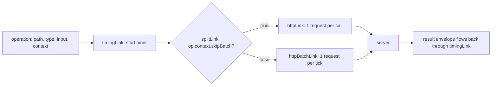

| Line / API | Role | What happens at runtime |
| :--- | :--- | :--- |
| `TRPCLink<AppRouter>` | Link type | The outer function runs once when the client is created; the inner one per operation. |
| `observable((observer) => ...)` | Result stream | Emits one value for queries and mutations, many for subscriptions. |
| `next(op).subscribe(...)` | Calls the rest of the chain | You can modify `op` first (add context, change input) or skip `next` to short-circuit (a cache). |
| `return () => sub.unsubscribe()` | Teardown | Runs on completion or abort; propagates cancellation down the chain. |
| `op.context` | Per-call metadata | Set with `{ context: {...} }` as the call's second argument. It is never sent to the server. |
| `splitLink({ condition, true, false })` | Router for operations | Each branch can be one link or an array of links. |

Common `splitLink` conditions: `op.type === 'subscription'` (send to `httpSubscriptionLink` or `wsLink`), `isNonJsonSerializable(op.input)` (send uploads through `httpLink`), and `op.path.startsWith('reports.')` (send slow procedures to a separate unbatched link).

### 3.8 Data Transformers: Keeping `Date`, `Map` and `bigint` Intact

JSON has no `Date`, `Map`, `Set`, `bigint` or `undefined`. A **transformer** serializes richer values on one side and restores them on the other. `superjson` is the usual choice. It must be configured on both the server and every terminating link. [`examples/03-superjson.ts`](examples/03-superjson.ts):

```ts
import type { AddressInfo } from 'node:net';
import { createTRPCClient, httpBatchLink } from '@trpc/client';
import { initTRPC } from '@trpc/server';
import { createHTTPServer } from '@trpc/server/adapters/standalone';
import superjson from 'superjson';

const t = initTRPC.create({ transformer: superjson });

const appRouter = t.router({
  snapshot: t.procedure.query(() => ({
    at: new Date('2026-01-01T00:00:00Z'),
    tags: new Set(['a', 'b']),
    big: 2n ** 64n,
  })),
});
type AppRouter = typeof appRouter;

const server = createHTTPServer({ router: appRouter });
server.listen(0, '127.0.0.1');
await new Promise((resolve) => server.once('listening', resolve));
const { port } = server.address() as AddressInfo;

const client = createTRPCClient<AppRouter>({
  // v11: the transformer is configured on the terminating link, not on the client root.
  links: [httpBatchLink({ url: `http://127.0.0.1:${port}`, transformer: superjson })],
});

const snap = await client.snapshot.query();
console.log(snap.at instanceof Date, snap.tags.has('b'), typeof snap.big); // true true bigint

server.close();
```

On the wire, superjson wraps the data as `{"json": {...}, "meta": {"values": {"at": ["Date"], ...}}}`, and inputs are wrapped the same way, so `curl` calls must send `?input={"json":{...}}`. The type side changes too: with a transformer, `inferRouterOutputs` keeps `Date` as `Date` instead of `string`.

| Option | Keeps rich types | Payload size | Non-TS clients and `curl` | Notes |
| --- | --- | --- | --- | --- |
| No transformer (default) | No (`Date` → string, `Map` → `{}`) | Smallest | Easy: plain JSON | The starter's choice; types reflect the serialized shape. |
| `superjson` | `Date`, `Map`, `Set`, `bigint`, `undefined`, `RegExp`, `URL`, custom classes via `registerCustom` | Larger (metadata) | Must wrap inputs in `{ json }` | Most common in Next.js apps. |
| Custom (`{ serialize, deserialize }`) | Whatever you implement | You decide | You decide | Use `devalue` or a combined `{ input, output }` transformer when the two directions differ. |

Pick one at the start of a project. Adding a transformer later changes the wire format for every procedure and breaks any client that is not updated in the same deploy.

### 3.9 Pitfalls

| Pitfall | Symptom | Fix |
| --- | --- | --- |
| Throwing from `createContext` for a missing token | Every call in the batch fails, including public ones like `system.health` | Return `user: null` and reject in `protectedProcedure`. |
| Not returning `next()` from middleware | Type error `Type 'undefined' is not assignable to type 'MiddlewareResult'`, or the procedure resolves to `undefined` | Always `return next(...)` (or the awaited result). |
| Reading `input` in middleware placed before `.input()` | `input` is `undefined` | Move the middleware after `.input()`, or `await getRawInput()`. |
| Using `rawInput` after upgrading to v11 | `Property 'rawInput' does not exist` | `const raw = await getRawInput()`. |
| Transformer on the server only | Client receives `{"json":...,"meta":...}` as the data; types claim `Date` but the value is an object | Add the same `transformer` to every terminating link. |
| Transformer on the client root (v10 style) | Type error: `Object literal may only specify known properties, and 'transformer' does not exist` | Move it into `httpBatchLink({ transformer })`. |
| Calling procedures via a caller inside resolvers | Middleware runs twice, logs double, auth checks repeated | Extract shared logic to plain functions. |
| Huge GET batches | `414 URI Too Long` or proxy `400` | Set `maxURLLength` on `httpBatchLink`. |
| Static `headers` object with a refreshable token | Requests keep sending the old token after refresh, then `UNAUTHORIZED` | Pass `headers` as a function. |
| Expensive queries in `createContext` | Every request, including health checks and public queries, pays for a database lookup it does not use | Keep context lazy: create handles there and run queries in the middleware or resolver that needs them. |

### 3.10 Best Practices

- Keep `createContext` cheap and non-throwing: it runs for every request, public or not.
- Split context into inner (request-independent) and outer (request parsing): tests and callers then share real wiring.
- Build a small set of procedure bases (`public`, `protected`, `admin`) and use only those in routers: auth is then visible in every procedure definition.
- Put tracing and timing middleware first: they then measure auth and validation too.
- Use `meta` for declarative policy (permissions, audit, cache hints): rules sit next to the procedure but are enforced in one middleware.
- Use callers for tests and server-only code paths, and at least one HTTP test per transport feature: callers skip serialization.
- Configure `headers` as a function and `maxURLLength` on batch links: tokens stay fresh and URLs stay under proxy limits.
- Decide on a transformer before the first client ships: changing it later is a breaking wire change.

### 3.11 Hands-on Exercise

Add request-scoped audit logging driven by meta.

1. Add `.meta<{ audit?: boolean }>()` to the `initTRPC` call in [`src/trpc.ts`](src/trpc.ts).
2. Write an `auditMiddleware` that, after `next()`, pushes `{ requestId, userId, path, ok }` to an exported array when `meta.audit` is true. Add it to `protectedProcedure`.
3. Mark `items.delete` and `items.setStatus` with `.meta({ audit: true })`.
4. In [`test/items.test.ts`](test/items.test.ts), call `setStatus` and a refused `delete` through `createCaller`, then assert the array contains two entries with `ok: true` and `ok: false`.
5. On the client, add a custom link (based on `timingLink` in [`examples/03-links.ts`](examples/03-links.ts)) that adds an `x-request-id` header. Hint: set `op.context.requestId`, then read it in the `headers` function of `httpBatchLink` through `opList`.

Expected: `npm test` passes, and running the server with `npm run dev` then `npm run client` prints one `[trpc] mutation items.delete error` line per refused delete. The reference for steps 1-3 is [`examples/03-middleware.ts`](examples/03-middleware.ts).

[Back to top ⤴️](#-table-of-contents)

---

## 4. Stage 4: Framework Integration: TanStack Query, Next.js & Adapters

This stage connects the router from Stages 1-3 to real front ends and hosting frameworks. It assumes React basics and the client link chain from Stage 3. Planned sections:

- 4.1 TanStack Query v5 in one page: query keys, stale time, `gcTime`, invalidation
- 4.2 `@trpc/tanstack-react-query`: `createTRPCContext`, `useTRPC()`, `queryOptions`, `mutationOptions`, `queryKey` and `pathFilter`
- 4.3 The classic `@trpc/react-query` hooks and when to keep them
- 4.4 Mutations, optimistic updates and cache invalidation
- 4.5 Next.js App Router: the fetch adapter route handler, server callers in React Server Components, prefetch and hydration
- 4.6 Express, Fastify and AWS Lambda adapters, and the fetch adapter on edge runtimes
- 4.7 CORS, cookies and credentials across origins

[Back to top ⤴️](#-table-of-contents)

---

## 5. Stage 5: Subscriptions, Streaming, Uploads & Testing

This stage covers everything beyond request/response JSON, and how to test it. It assumes Stage 3's links. Planned sections:

- 5.1 Async-generator subscriptions and `signal` handling
- 5.2 `httpSubscriptionLink` over Server-Sent Events, reconnection and `tracked()` event ids
- 5.3 `wsLink` and `createWSClient`, connection params and authentication
- 5.4 `httpBatchStreamLink` and streamed outputs
- 5.5 `FormData`, `File` and binary inputs with `httpLink` and `isNonJsonSerializable`
- 5.6 Testing strategy: callers, `localLink`, real HTTP servers, contract tests and type tests

[Back to top ⤴️](#-table-of-contents)

---

## 6. Stage 6: Performance, Security, Observability & Deployment

This stage is about running tRPC in production. Planned sections:

- 6.1 Type-checking cost in large routers and how to keep the editor fast
- 6.2 Batching limits, streaming and HTTP caching with `responseMeta`
- 6.3 Security: input limits, CSRF and CORS, rate limiting, error message hygiene
- 6.4 OpenTelemetry tracing and error reporting from `onError`
- 6.5 Evolving the API without breaking deployed clients
- 6.6 Exposing REST or OpenAPI next to tRPC for third parties
- 6.7 Containers and serverless deployment (this repo's Dockerfile and CI)

[Back to top ⤴️](#-table-of-contents)

---

## M1. Masterclass: Type Inference Internals

How `typeof appRouter` becomes a typed proxy client: the router record type, procedure `_def` types, the recursive proxy, and why large routers slow the editor.

[Back to top ⤴️](#-table-of-contents)

---

## M2. Masterclass: Real-time Systems with SSE and WebSockets

Designing live features on tRPC subscriptions: fan-out through Redis or Postgres `LISTEN/NOTIFY`, resumable streams with `tracked()`, back-pressure and connection limits.

[Back to top ⤴️](#-table-of-contents)

---

## M3. Masterclass: Monorepo and Large-Router Architecture

pnpm or npm workspaces with Turborepo, a shared `@acme/api` package, router splitting by domain, lazy routers, and type-checking budgets.

[Back to top ⤴️](#-table-of-contents)

---

## M4. Masterclass: Authentication, Authorization and Multi-tenancy

Sessions versus JWTs in `createContext`, permission meta, row-level tenant scoping, and auditing.

[Back to top ⤴️](#-table-of-contents)

---

## M5. Masterclass: Flagship Blueprint: Full-Stack Next.js and tRPC Application

An end-to-end build that combines the stages: Next.js App Router, `@trpc/tanstack-react-query`, a database layer, authentication, subscriptions, tests and deployment.

[Back to top ⤴️](#-table-of-contents)

---

## 7. Stage 7: Staff tRPC API Engineer Interview Handbook & Cheatsheet

### 7.1 Core Concepts (Q1-Q4)

#### Q1. What are the fundamental architectural trade-offs of tRPC?

tRPC trades reach for speed of change. Because the contract is the router's TypeScript type, there is no schema to write, no generator to run and no drift between server and client: a rename on the server becomes a compile error at every call site in the same commit. Refactoring across the stack is as safe as refactoring inside one package.

The price is that only TypeScript clients that can see the router's source (or its published declarations) benefit. A Swift app, a partner integration or a Go service sees a plain JSON-over-HTTP API with no published schema, so tRPC is a poor fit as the only interface of a public API. It also couples deploy order: an old client and a new server are not checked against each other. Large routers can make type-checking slow, because every client file depends on the full inferred type. Teams usually accept these costs for an internal full-stack TypeScript product and avoid them for public or polyglot APIs, often by exposing REST or GraphQL beside tRPC.

#### Q2. How does tRPC give end-to-end types without code generation?

The server exports `type AppRouter = typeof appRouter`. That type encodes every procedure path, its kind, the input type derived from its validator and the output type derived from its resolver's return type. The client imports it with `import type`, which the compiler erases, and passes it as a generic to `createTRPCClient<AppRouter>`. The client object is a recursive JavaScript `Proxy`: property access records a path, and `.query()` / `.mutate()` sends that path and the input over the configured links.

So the types exist only at compile time and the runtime contains no server code. Runtime safety comes from the validator in `.input()`, which tRPC also uses as the source of the input type, so the static contract and the runtime check cannot diverge.

#### Q3. When should a procedure be a query and when a mutation?

A query must be safe to run many times: it reads and has no side effects. tRPC serves queries over GET, which means browsers, proxies and CDNs may cache them, clients may retry them, and TanStack Query refetches them on focus, reconnect and remount. A mutation is anything with side effects, served over POST and never retried or refetched automatically.

Putting a write behind a query is a real production bug: an "increment view count" or "send email" query runs every time the user switches tabs. The test is simple: if calling it twice is not the same as calling it once, it is a mutation.

#### Q4. How do tRPC errors map to HTTP, and what does the client receive?

Resolvers throw `TRPCError` with a code such as `NOT_FOUND` or `FORBIDDEN`. The adapter maps it to an HTTP status (404, 403) and serializes a JSON-RPC style envelope: `{ error: { message, code: <JSON-RPC number>, data: { code, httpStatus, path, stack? } } }`. Any non-`TRPCError` exception becomes `INTERNAL_SERVER_ERROR` (500) and keeps the original error as `cause` on the server only. An `errorFormatter` can add fields to `data`, such as flattened Zod errors, and its return type is inferred on the client.

On the client every failure is a `TRPCClientError<AppRouter>`, whose `data` is typed from the formatter, so code can branch on `err.data?.code` without casts. In batches each call fails independently, and the response status is 207 when results are mixed.

### 7.5 Staff Cheatsheet

| Need | tRPC answer | Gotcha |
| --- | --- | --- |
| Validate runtime config | Parse `process.env` with a Zod schema at startup | Fail fast; do not validate lazily inside procedures. |
| Structured domain errors | `throw new TRPCError({ code, message, cause })` | Plain `Error` becomes a 500 and pages someone. |
| Field-level validation messages | `errorFormatter` + `z.flattenError(error.cause)` | Zod 3 used `error.flatten()`. |
| Auth for many procedures | `protectedProcedure = publicProcedure.use(...)` with `next({ ctx: { user } })` | Ownership checks still belong in the resolver. |
| Call a procedure without HTTP | `t.createCallerFactory(appRouter)(ctx)` | Skips serialization: `Date` stays `Date`. |
| Fewer HTTP requests | `httpBatchLink` with `maxURLLength` and `maxItems` | One slow call delays the whole batch; use `httpBatchStreamLink`. |
| Keep `Date`/`Map`/`bigint` | `transformer: superjson` on server and on every terminating link | Changing it later breaks old clients. |
| Graceful shutdown | `server.close()` on `SIGTERM` with a forced-exit timer | Containers kill the process after the grace period. |

[Back to top ⤴️](#-table-of-contents)

---

## 🧪 Example Projects

| Project | Builds on | What you practise | Stretch goal |
| --- | --- | --- | --- |
| [Starter project](./src) (in this repo) | [Stages 1-3](#1-stage-1-foundations-mental-model--first-api) | Routers, Zod validation, protected and admin procedures, `createCaller` tests, HTTP tests, Docker | Replace `ItemStore` with SQLite through Drizzle or Prisma and keep every test green |
| Typed todo CLI | [1.4](#14-the-smallest-complete-program), [3.6](#36-the-client-and-the-link-chain) | A Node client using `createTRPCClient` against the starter | Add `--json` output typed with `RouterOutputs` |
| Form with server-side validation | [2.2](#22-input-validation-with-zod-and-standard-schema), [2.6](#26-shaping-errors-with-errorformatter) | Shared Zod schemas, showing `zodError.fieldErrors` next to inputs | Share the same schema with a form library on the client |
| Role-based admin panel | [3.3](#33-context-narrowing-and-protected-procedures), [3.4](#34-meta-reusable-middleware-and-concat) | Permission meta, `adminProcedure`, audit middleware | Per-tenant roles stored in a database |
| Link playground | [3.7](#37-splitlink-and-writing-a-custom-link) | Custom links, `splitLink`, request ids, retries | A caching link that answers repeated queries from memory for 5 s |
| Rich-type API | [3.8](#38-data-transformers-keeping-date-map-and-bigint-intact) | `superjson`, `Date`/`bigint` end to end | Register a custom class (for example a `Money` type) with `superjson.registerCustom` |
| Next.js dashboard | Stage 4 | TanStack Query integration, prefetching in Server Components | Optimistic updates with rollback |
| Live notifications | Stage 5, M2 | SSE subscriptions with `tracked()` ids | Fan-out across instances through Redis pub/sub |

## 📝 Cheat Sheets

### CLI / Commands

```bash
npm install @trpc/server @trpc/client zod         # core packages
npm install @trpc/tanstack-react-query @tanstack/react-query   # React integration
npm install superjson                             # optional transformer
npm ls @trpc/server                               # check for duplicate versions
npx @trpc/upgrade                                 # official upgrade codemods

npm ci                                            # starter: install from lockfile
npm run dev                                       # starter: tsx watch on port 8080
npm run client                                    # starter: run the typed client
npm run lint                                      # starter: tsc --noEmit over src, test, examples
npm test                                          # starter: Vitest
npm run build && npm start                        # starter: compile to dist/ and run with node
npx tsx examples/03-links.ts                      # run one README example

docker build -t learn-trpc .                      # multi-stage image
docker run --rm -p 8080:8080 learn-trpc           # serve on http://localhost:8080

curl -s localhost:8080/trpc/system.health                                   # query, no input
curl -s "localhost:8080/trpc/items.byId?input=%7B%22id%22%3A%221%22%7D"      # query with input
curl -s -X POST localhost:8080/trpc/items.create \
  -H 'content-type: application/json' \
  -H 'authorization: Bearer demo-member-token' \
  -d '{"title":"From curl"}'                                                # mutation
```

### Syntax / API Quick Reference

| Task | Code |
| --- | --- |
| Create the instance | `const t = initTRPC.context<Context>().meta<Meta>().create({ transformer, errorFormatter })` |
| Router | `t.router({ items: itemsRouter, health: t.procedure.query(() => 'ok') })` |
| Flatten routers | `t.mergeRouters(a, b)` |
| Query with input | `t.procedure.input(z.object({ id: z.string() })).query(({ input, ctx }) => ...)` |
| Mutation | `t.procedure.input(schema).mutation(({ input }) => ...)` |
| Output validation | `.output(z.object({ ... }))` |
| Middleware | `t.procedure.use(async ({ ctx, next }) => next({ ctx: { user } }))` |
| Raw input in middleware | `const raw = await getRawInput()` |
| Combine builders | `base.concat(plugin.procedure)` |
| Error | `throw new TRPCError({ code: 'NOT_FOUND', message, cause })` |
| Export the contract | `export type AppRouter = typeof appRouter` |
| Infer types | `inferRouterInputs<AppRouter>['items']['create']`, `inferRouterOutputs<AppRouter>[...]` |
| Server-side caller | `t.createCallerFactory(appRouter)(ctx).items.list()` |
| Standalone server | `createHTTPServer({ router, createContext, basePath: '/trpc/' }).listen(8080)` |
| Client | `createTRPCClient<AppRouter>({ links: [httpBatchLink({ url, headers })] })` |
| Call | `await client.items.byId.query({ id })`, `await client.items.create.mutate({ title })` |
| Per-call context | `client.x.query(input, { context: { skipBatch: true } })` |
| Route operations | `splitLink({ condition: (op) => op.type === 'subscription', true: ..., false: ... })` |
| Client error check | `if (err instanceof TRPCClientError) err.data?.code` |

## 📚 Resources

- [tRPC documentation](https://trpc.io/docs)
- [tRPC v11 migration guide](https://trpc.io/docs/migrate-from-v10-to-v11)
- [tRPC release notes](https://github.com/trpc/trpc/releases)
- [tRPC source repository](https://github.com/trpc/trpc)
- [tRPC blog](https://trpc.io/blog)
- [Zod documentation](https://zod.dev)
- [Standard Schema specification](https://standardschema.dev)
- [TanStack Query documentation](https://tanstack.com/query/latest)
- [TypeScript `strict` option](https://www.typescriptlang.org/tsconfig/#strict)

## 🤝 Contributing

Contributions are welcome. Read the [contributing guide](https://github.com/TheLearningHubOrg/.github/blob/main/CONTRIBUTING.md) and the [code of conduct](https://github.com/TheLearningHubOrg/.github/blob/main/CODE_OF_CONDUCT.md) before you open a pull request. Commit messages follow [Conventional Commits](https://www.conventionalcommits.org/), which drive the automated changelog.

## 📄 License

This project is licensed under the MIT License. See the [LICENSE](LICENSE) file for details.

## 🙏 Acknowledgments

- [tRPC](https://trpc.io) and its maintainers
- [Zod](https://zod.dev) for runtime validation
- [Vitest](https://vitest.dev) for the test suite
- [tsx](https://tsx.is) for running TypeScript directly in development
- [superjson](https://github.com/flightcontrolhq/superjson) for the transformer example
- [Node.js](https://nodejs.org) and the official `node` Docker images

## 🌐 Connect with me

- [Twitter](https://twitter.com/manthan_ank)
- [LinkedIn](https://www.linkedin.com/in/manthanank)
- [Facebook](https://www.facebook.com/manthanank/)
- [Instagram](https://www.instagram.com/manthan_ank/)
- [YouTube](https://www.youtube.com/@manthanank)
- [GitHub](https://github.com/manthanank)

## ☕ Support

If you like this learning repository and find it useful, consider buying me a coffee or sponsoring me through GitHub Sponsors. Your support helps me keep these guides up to date. Thank you!

[](https://www.buymeacoffee.com/manthanank)

[](https://github.com/sponsors/manthanank)

---

Show your support by 🌟 the repository.
